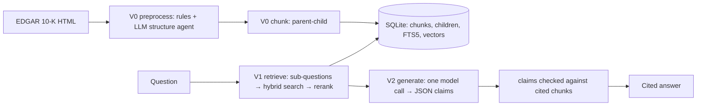

# 10k-agent

**Grounded, cited answers over SEC 10-K filings, built one tested version at a time.** Ask a question about the companies' annual reports; it finds the passages, answers from them alone with every number tied to the chunk it came from, checks each number against that chunk, and declines when the filings can't answer.

```text
$ tenk ask "What were Apple's total net sales in fiscal 2025?"

Chunks (8)
   1. AAPL-FY2025-7-016  AAPL FY2025 item 7 table p.23
   2. AAPL-FY2025-8-071  AAPL FY2025 item 8 table p.48
   3. AAPL-FY2025-8-002  AAPL FY2025 item 8 table p.29
   …

Answer

Apple's total net sales for fiscal 2025 were $416,161 million.

Claims (1)
  [1] verified   Apple's total net sales for fiscal 2025 were $416,161 million. = 416161 USD millions
       cites AAPL-FY2025-8-002 · found '416,161' in AAPL-FY2025-8-002
```
*A real run, abridged (here with gpt-oss-20b on vLLM; the default model is Qwen3.6-27B): the answer cites the income statement chunk, and the check found the number in it.*

## Pipeline



Each version adds one stage, and each was tested on its own before the next was built. Every version has a guide in `docs/` (how to use it) and an experiment in `experiments/` (design, metrics, results).

| Version | Adds | Guide | Experiment and results |
|---|---|---|---|
| **V0 · Parsing and chunking** | 10-K HTML → blocks (rules) → labels (LLM structure agent, validated and repaired) → one structured document → chunks, three ways | [V0_PARSING_CHUNKING.md](docs/V0_PARSING_CHUNKING.md) | [V0](experiments/V0_PARSING_CHUNKING.md): rule-based and parent-child level (~93% exact heading paths, every risk factor on its own) |
| **V1 · Retrieval** | Sub-questions per company and filing → keyword + dense → RRF → rerank → round-robin. No LLM | [V1_RETRIEVAL.md](docs/V1_RETRIEVAL.md) | [V1](experiments/V1_RETRIEVAL.md): parent-child best, Recall@5 87.3%, MRR 0.758 |
| **V2 · Generation** | One model call over V1's top 8 → JSON answer with claims citing chunk IDs → each claim checked | [V2_GENERATION.md](docs/V2_GENERATION.md) | [V2](experiments/V2_GENERATION.md): 21 / 30 number questions right, 8 / 8 declines, every numeric claim grounded |

V3–V6 (agent, verified agent, model comparison, fine-tuning) were built on an earlier V0–V2 and are kept in [`archive/`](archive/README.md) as references for rebuilding them on this pipeline.

**Corpus:** Apple, Microsoft, Amazon, Alphabet, Meta, NVIDIA, Tesla, Netflix × fiscal years 2023–2025 (24 10-Ks), chosen because their fiscal years end in different months: "NVIDIA's revenue in 2024" is mostly its fiscal 2025 ([D-001](docs/DECISIONS.md#d-001)). Built and tested so far: the FY2025 filings of AAPL, AMZN, MSFT and NVDA.

**Rules.** Every number comes from a cited passage, never from the model's memory. Fiscal years come from filing metadata. Unverifiable claims are shown as unverified, not hidden. No stock prices, forecasts or investment advice.

## Requirements

| | Minimum | Tested |
|---|---|---|
| OS | Linux or macOS | Ubuntu 24.04 |
| Python | 3.12 + [uv](https://docs.astral.sh/uv/) | 3.12 |
| GPU | ~40 GB for the default 27B model on vLLM; the embedder and reranker also run on CPU, slower | L40S, 46 GB |
| Model | An open model on vLLM, or `ANTHROPIC_API_KEY` (Claude) for answers | Qwen3.6-27B-FP8; judge gpt-oss-20b |
| Disk | 10 GB (filings 150 MB, local models 3.5 GB, venv 6 GB) | |

## Install

```bash
git clone <this repo> && cd 10k-agent
uv sync --extra local --extra chunking               # Python deps + local embedder / reranker + the chunkers
export SEC_USER_AGENT="Your Name you@example.com"
uv run tenk fetch                                    # 24 10-Ks from EDGAR (cached)
scripts/serve_vllm.sh qwen3.6-27b-fp8                # the default model, other terminal (docs/SERVING.md)
taskset -c 16-31 uv run tenk build --stage chunk     # V0 on every filing (~35–60 min each, 8 at once)
taskset -c 16-31 uv run tenk build --stage load --stage embed    # V1's database and vectors
```

Every setting is in [`config.yaml`](config.yaml), one section per stage; `TENK_CONFIG=<file>` or `--config` uses another.

## Run it

```bash
tenk search "How much did NVIDIA spend on R&D in fiscal 2025?"     # V1: sub-questions and the top chunks
tenk ask "What were Apple's total net sales in fiscal 2025?"        # V2: one cited answer
tenk chat                                                           # V2: type questions, models loaded once
tenk gold show aapl-net-sales-fy2025                                # a gold question with its source text
```

Each experiment runs and scores one version (pinned to the E-cores, [I-001](docs/DECISIONS.md#i-001)):

```bash
taskset -c 16-31 python experiments/v0/run.py       # V0: preprocess an excerpt, chunk it three ways, score vs the ground truth
taskset -c 16-31 python experiments/v1/run.py       # V1: Recall@k and MRR on 46 gold questions
taskset -c 16-31 python experiments/v2/run.py       # V2: 54 questions × three contexts; then judge.py with the judge served
```

## Documentation

| Guide | Covers |
|---|---|
| [V0 · Parsing and chunking](docs/V0_PARSING_CHUNKING.md) | Fetch, the corpus build, blocks, the structure agent, the document, the three chunkers |
| [V1 · Retrieval](docs/V1_RETRIEVAL.md) | The database, decomposition, hybrid search, rerank, merge; the gold-question format |
| [V2 · Generation](docs/V2_GENERATION.md) | Prompt, rules, answer format, claim checks |
| [Serving](docs/SERVING.md) | The model layer, vLLM presets |
| [Decisions & issues](docs/DECISIONS.md) | Why things are the way they are, known issues |
| [Experiments](experiments/README.md) | Each version's design, metrics and results |

## Repository

| Path | Contents |
|---|---|
| `src/tenk_agent/` | Shared: `config`, `corpus` (the companies and years), `store` (SQLite), `models`, `build` (the corpus build), `cli` |
| `src/tenk_agent/acquisition/` | `tenk fetch`: the corpus 10-Ks from SEC EDGAR (`edgar`), with `raw/manifest.json` |
| `src/tenk_agent/preprocess/` | V0 step 1 `blocks` (rules), step 2 `structure` (the LLM agent, assembly) and its `validation` rules |
| `src/tenk_agent/chunking/` | V0 `rule_based`, `parent_child`, `agentic`, and what they share (`common`) |
| `src/tenk_agent/retrieval/` | V1 `index` (database, vectors), `decompose`, `search`, `embeddings` (embedder, reranker) |
| `src/tenk_agent/generation/` | V2 `generate`, `answers`, `verify`, `calculator` |
| `src/tenk_agent/evaluation/` | Gold sets (`gold`, `render`), retrieval metrics, number scoring, the LLM judge |
| `src/tenk_agent/prompts/` | Every LLM prompt, one Markdown file per task, its output schema beside it: `structure.md` + `structure.schema.json`, `answer.md`, `judge.md` |
| `experiments/` | One folder per version: its runner, scoring, config and test data; `V*.md` design and results |
| `archive/` | V3–V6, for reference only |
| `docs/` | Guides, serving, decisions |
| `scripts/` | `serve_vllm.sh` (open models) |
| `config.yaml` | Every setting for the CLI, per stage |
| `data/`, `output/` | Filings, work files, databases; experiment outputs (generated, git-ignored) |
| `tests/` | Unit tests, no GPU or model (`env -u PYTHONPATH uv run pytest` on this machine, [I-010](docs/DECISIONS.md#i-010)) |

## Development rules

| Area | Rule |
|---|---|
| Product | Numbers only from cited passages · fiscal years from `filings.fiscal_year` · unverifiable claims labeled, never dropped · decline outside the corpus · no prices, forecasts or advice |
| Code | Pipeline code in `src/tenk_agent/`, experiments only run and score it · settings in `config.yaml` (experiments: their own `config.yaml`) · prompts in `prompts/` · database only through `Store` · EDGAR: declared User-Agent, ≤ 10 requests/s |
| Checks | `uv run ruff format && uv run ruff check` · `env -u PYTHONPATH uv run pytest` |
| Eval | Gold sets reviewed by a person · never edit a gold set to pass a run · results recorded in the version's `experiments/V*.md` |
| Docs | A pipeline change updates its `docs/V*.md`; an experiment its `experiments/V*.md` · decisions and issues go in [DECISIONS.md](docs/DECISIONS.md) |
| Commits | One line with a type prefix: `feat`, `fix`, `docs`, `refactor`, `chore`, `style`, `test` |
