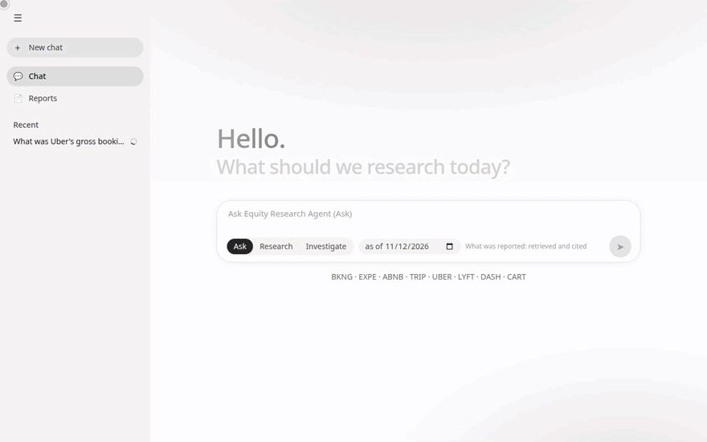
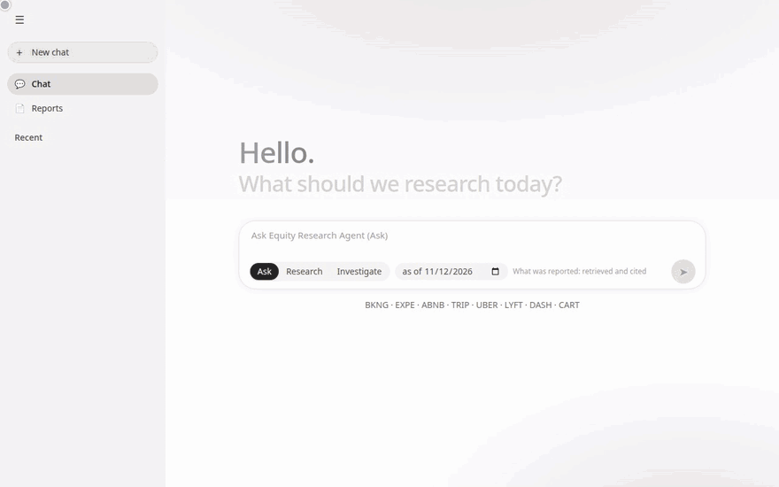
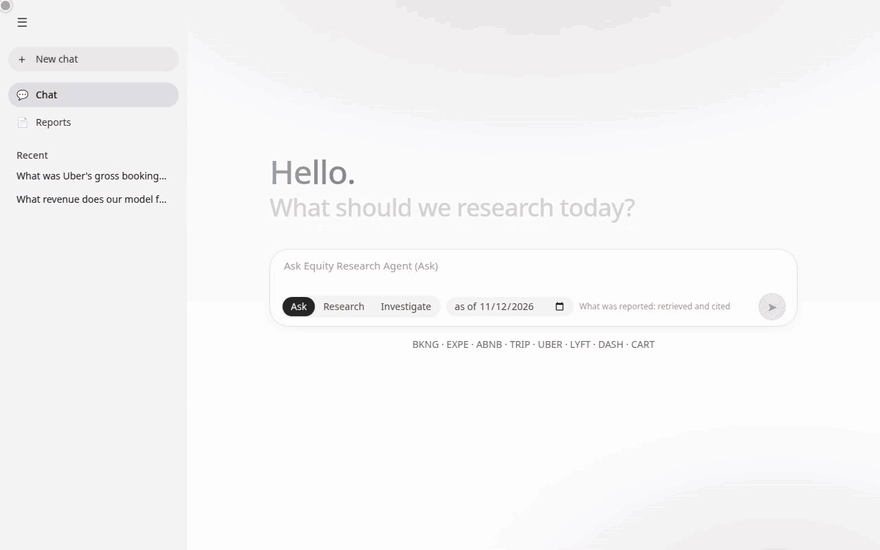
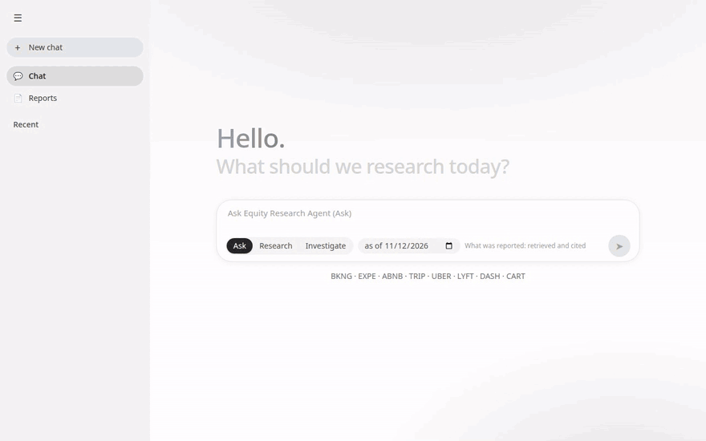

<p align="center">
  <h1 align="center">Equity Research Agent</h1>
  <p align="center">
    <strong>An AI financial analyst that researches equities, builds forecasts, and writes earnings notes</strong>
  </p>
  <p align="center">
    <a href="https://github.com/Michae1Park/equity-research-agent/actions/workflows/ci.yml"></a>
    <a href="https://www.python.org/downloads/"></a>
    <a href="https://github.com/astral-sh/uv"></a>
  </p>
</p>

---

<p align="center">
  <b>Author:</b> <a href="https://michae1park.github.io">Michael Park</a>
</p>

---

## Overview

An agent that covers eight US travel and mobility companies (**BKNG, EXPE, ABNB, TRIP, UBER, LYFT, DASH, CART**) the way a junior sell-side analyst would. It answers questions from filings, forecasts and values each company with a formula-driven model, and writes a draft earnings note for a senior analyst to review. It runs on a local open model (Qwen3.6-27B on vLLM) and uses only free public data: SEC filings, XBRL, earnings releases, FRED, BTS and NYC TLC.

**Every run takes an as-of date** and sees only data filed strictly before it, so any past quarter can be replayed and backtested. **Every number cites its source:** each claim is checked against the passage, fact or model cell it cites, and the agent declines when the data can't answer.

**Research: an answer computed from the model.** The agent runs the forecast and reads management's guidance, then answers with model and guidance ids it can check.

<p align="center">
  
</p>

**Ask: a cited answer from filed data, or a decline.** Each number links to the KPI or passage it came from. When the filings don't have the answer, the agent says so instead of guessing.

<p align="center">
  
</p>

**Investigate: a multi-part question, planned.** The planner splits the question into Ask and Research sub-runs and combines their answers into one claim-checked answer.

<p align="center">
  
</p>

**Report: a draft earnings note.** Ten sections, every figure traced to the evidence log, with a model-change workbook and an exception log.

<p align="center">
  
</p>

<sub>**About the numbers in the Report demo:** prices, and every value derived from them (rating, price target, return, market cap, EV, multiples, WACC, beta, DCF values), come from licensed third-party data, so the real values are redacted. The ones shown in the Report demo are made up for illustration. Filing-derived figures (revenue, EBITDA, gross bookings) are real. To see the true numbers, run the report locally with your own keys (see Quickstart).</sub>

### What It Does

| Mode | You give it | You get |
|---|---|---|
| **Ask** | A question + as-of | A short answer from filed data, every number cited and checked |
| **Research** | A question + as-of | An answer computed from the model (forecast, scenario, valuation), with its assumptions shown |
| **Investigate** | A multi-part question + as-of | A plan of Ask and Research sub-runs, combined into one claim-checked answer |
| **Report** | Ticker + as-of | A 10-section draft note (Markdown and PDF), a model-change workbook (live Excel formulas) and an evidence and exception log |

```text
Ask, as of 2026-11-12: "What was Uber's gross bookings growth in Q2 2026 and what drove it?"
```

The agent:
1. Reads Uber's gross bookings for Q2 2026 and Q2 2025 from the extracted KPIs (each tied to the release table it came from)
2. Computes the growth with the calculator tool instead of doing the arithmetic in the model
3. Searches the earnings release for the drivers (trips, monthly active consumers, segments)
4. Writes a JSON answer whose claims cite KPI and chunk ids
5. Checks every claim's number against what it cites, marks each one verified, cited or unverified, and shows unverified claims instead of hiding them

**Results** ([full results and limits](docs/V4_RESULTS.md)):

| Test | Result |
|---|---|
| Ask: 79 questions | **89.9%** correct and verified; 100% of cited ids resolve |
| KPI extraction: 337 hand-checked labels | **98.5%** exact; 100% on revenue, EPS and the main KPI |
| Next-quarter forecast: 90 walk-forward points | revenue MAPE **3.14%** vs seasonal naive 3.77% (not statistically significant) |
| Draft notes: all eight companies | 10 sections, **100%** of figures traced, all 474 seeded errors caught |

---

## Architecture

<p align="center">
  
</p>

| Layer | What it does |
|---|---|
| **Acquisition** | Fetches 10-Ks, 10-Qs, earnings releases (8-K Ex. 99.1), proxies, Form 4s, XBRL company facts, prices, FRED/ALFRED macro, the equity risk premium, BTS airline passengers and NYC TLC trips into a local cache |
| **Store** | One SQLite file holding chunks, FTS5, vectors, XBRL facts, extracted KPIs and guidance, and market series. It is read only through an **AsOf** filter, so nothing filed on or after the as-of date is visible |
| **Retrieval** | Keyword + dense search, fused with RRF, then reranked, over parent-child chunks of every filing |
| **Model engine** | A history model with integrity checks (balance, quarters sum, Q4 ties, segments), a driver-based forecast anchored to guidance, and a DCF plus peer-multiple valuation |
| **Agent** | A tool-calling loop (search, KPIs, facts, calculator, model and valuation tools) that writes a JSON answer with cited claims |
| **Investigate planner** | Splits a multi-part question into Ask and Research sub-runs, can add a follow-up, and combines the sub-answers into one answer that is claim-checked again |
| **Report pipeline** | Eleven fixed steps (S1–S11), with the LLM only for events, forecast proposals, debates and the write-up. Exports a note, a workbook whose formulas recalculate to Python's values, and a saved model version |
| **Web app** | FastAPI with server-sent events and a React UI: chat with a live trace and source drawer, plus report generation and review |

**Rules:** every number comes from a cited source, never from the model's memory; unverified claims are shown, not hidden; ratings and price targets are drafts until a human approves them.

**Built one tested version at a time:**

| Version | Adds | Results |
|---|---|---|
| V0 · Parsing and chunking | 10-K HTML → structured document → parent-child chunks | [~93% exact heading paths](experiments/V0_PARSING_CHUNKING.md) |
| V1 · Retrieval | Hybrid search → RRF → rerank | [Recall@5 87.3%](experiments/V1_RETRIEVAL.md) |
| V2 · Generation | JSON claims citing chunk ids, each claim checked | [21 / 30 numeric questions right, 8 / 8 declines](experiments/V2_GENERATION.md) |
| V3 · Agent | Tool use (search, calculator, XBRL, EDGAR) | [87–89% vs V2's 66.7%](experiments/V3_AGENT.md) |
| **V4 · Research agent** | As-of store, KPI extraction, forecast and valuation model, Research / Investigate / Report modes, web app | [V4 results](docs/V4_RESULTS.md) |

Design: [spec](docs/V4_SPEC.md), [technical design](docs/V4_TECHNICAL_DESIGN_DOC.md), [architecture and doc map](docs/ARCHITECTURE.md).

---

## Quickstart

**Needs:** Linux or macOS, Python 3.12 + [uv](https://docs.astral.sh/uv/), a ~40 GB GPU for the default 27B model, and your own free SEC User-Agent, Tiingo and FRED keys ([all requirements](docs/GETTING_STARTED.md#requirements)).

```bash
git clone https://github.com/Michae1Park/equity-research-agent.git && cd equity-research-agent
uv sync --extra local --extra chunking
source .venv/bin/activate
era setup                                   # your SEC, Tiingo and FRED credentials (gitignored)
export ERA_COMPANIES=companies.yaml         # the eight-company corpus

scripts/serve_vllm.sh qwen3.6-27b-fp8       # the model for local runs, in its own terminal

# Build the corpus (cached; heavy steps pinned to E-cores)
era fetch && era fetch --market
taskset -c 16-31 era build --stage chunk --stage load --stage facts --stage market --stage embed
taskset -c 16-31 python experiments/v4/extract_pilot.py --releases all   # KPIs and guidance
era build --stage kpis
```

**Use it:**

```bash
era research report UBER --as-of 2026-08-06    # draft note, workbook and logs → output/reports/
docker compose up --build                      # vLLM + web UI/API on :8000 (stop local vLLM first)
```

Full steps, the evaluations and troubleshooting: [Getting started](docs/GETTING_STARTED.md). Serving presets: [SERVING.md](docs/SERVING.md).
