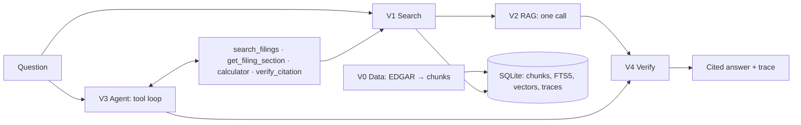

# 10k-agent

**Grounded, cited research over SEC 10-K filings, with an evaluation that proves it works.** Ask a question about 8 companies' annual reports; it finds the passages, calculates with a tool, checks every number against its source, and says plainly when the filings can't answer.

```text
$ tenk research "What was Google's capital expenditure in 2025?"
✓ Searching GOOGL FY2025 for “capital expenditure”
    5 results: GOOGL-FY2025-7-035, GOOGL-FY2025-7-012, GOOGL-FY2025-7-002, GOOGL-FY2025-8-117, GOOGL-FY2025-1A-001
✓ Verifying 91.4 in GOOGL-FY2025-7-035
    found '$91.4 billion'
✓ Verifying 91.4 in GOOGL-FY2025-7-012
    found '$91.4 billion'
✓ Calculating pct_change
    (new - old) / old * 100 = 74.0952
Google (Alphabet) reported capital expenditures of $91.4 billion for fiscal year 2025, which ended on December 31, 2025 [1].
This represents a 74.1% increase from $52.5 billion in fiscal year 2024 [2]. …
  [1] verified   Google (Alphabet) reported capital expenditures of $91.4 billion for fiscal year 2025.  (GOOGL-FY2025-7-035, GOOGL-FY2025-7-012)
  [2] verified   Google (Alphabet) reported capital expenditures of $52.5 billion for fiscal year 2024.  (GOOGL-FY2025-7-035)
  [3] calculated Google's capital expenditures in fiscal year 2025 increased by 74.1% compared to fiscal year 2024.  (GOOGL-FY2025-7-035)

openai:Qwen/Qwen3.5-9B · 27.2s · 23,213 in / 1,056 out · $0.0062
```
*A real Research-mode run (Qwen3.5-9B on vLLM): "Google" resolved to Alphabet, the growth rate came from the calculator, and every number points at the chunk that shows it.*

## Pipeline



Built in versions, each adding one thing to the one before. Each has a guide in `docs/`, and a folder `versions/vN_*/` with a `run.sh` that runs and scores that version alone and a playground script ([D-028](docs/DECISIONS.md#d-028)).

| Version | Adds | Question it answers | Guide |
|---|---|---|---|
| **V0 · Data** | EDGAR HTML → sections by Item → chunks; tables kept whole | What's in each 10-K, and where? | [V0_DATA.md](docs/V0_DATA.md) |
| **V1 · Search** | Dense vectors + cross-encoder rerank, one search per company and filing named. No LLM | Which passages answer this? | [V1_SEARCH.md](docs/V1_SEARCH.md) |
| **V2 · RAG** (Ask mode) | One model call over the top 8 chunks → JSON claims with chunk IDs | What's the short, cited answer? | [V2_RAG.md](docs/V2_RAG.md) |
| **V3 · Agent** (Research mode) | Hand-written tool loop: search, read sections, calculate; streams each step | What does a multi-step question need? | [V3_AGENT.md](docs/V3_AGENT.md) |
| **V4 · Verified agent** | Every number checked against its source; failed claims labeled, one repair round; LLM judge | Is every number really in what it cites? | [V4_VERIFIED_AGENT.md](docs/V4_VERIFIED_AGENT.md) |
| **V5 · Model comparison** | V4 with each open model (+ Claude with a key) | Which model should run it? | [V5_MODELS.md](docs/V5_MODELS.md) |
| **V6 · Fine-tune + ablation** | LoRA on the 9B's own passing runs; one-change-at-a-time rows (closed-book, no rerank, no verify, XBRL, …) | Can tuning close the gap? What does each part add? | [V6_FINETUNE_ABLATION.md](docs/V6_FINETUNE_ABLATION.md) |
| **Evaluate** | 100-question gold set; retrieval, answer, agent and cost metrics; intervals and paired tests | Does it work, and how well? | [EVAL](docs/EVAL.md) |

**Corpus:** Apple, Microsoft, Amazon, Alphabet, Meta, NVIDIA, Tesla, Netflix × fiscal years 2023–2025 (24 10-Ks, 6,299 chunks). Chosen because their fiscal years end in different months: "NVIDIA's revenue in 2024" is mostly its fiscal 2025 ([D-001](docs/DECISIONS.md#d-001)).

**Rules.** Every number comes from a cited passage or the calculator, never from the model's memory. Fiscal years come from filing metadata. Unverifiable claims are shown as unverified, not hidden. No stock prices, forecasts or investment advice.

## Requirements

| | Minimum | Tested |
|---|---|---|
| OS | Linux or macOS | Ubuntu 24.04 |
| Python · Node | 3.12 + [uv](https://docs.astral.sh/uv/) · 20+ (UI only) | 3.12.3 · 24.15 |
| GPU | None (local models run on CPU, slower) | L40S, 46 GB |
| Model | An open model on vLLM (GPU: ≥ 24 GB for the 9B, ~40 GB for the 27B default), or `ANTHROPIC_API_KEY` (Claude) | Qwen3.6-27B-FP8, Qwen3.5-9B; judge gpt-oss-20b |
| Disk | 10 GB (filings 150 MB, local models 3.5 GB, venv 6 GB) | |

## Install

```bash
git clone <this repo> && cd 10k-agent
uv sync --extra local                          # Python deps + local embedding / reranker models
                                               # (+ --extra finetune for V6 training)
export SEC_USER_AGENT="Your Name you@example.com"
uv run tenk fetch                              # 24 10-Ks from EDGAR (cached)
uv run tenk ingest                             # parse + chunk → data/tenk.db (~30 s)
uv run tenk embed                              # vectors for retrieval (~2 min on a GPU)
scripts/serve_vllm.sh qwen3.6-27b-fp8          # the default model, other terminal (docs/SERVING.md)
```

Every knob is in [`config.yaml`](config.yaml), per stage. `TENK_MODEL`, `TENK_EMBEDDER`, `TENK_RERANKER`, `OPENAI_BASE_URL` and other `TENK_*` variables override it.

## One version at a time

Start at V0 and go up; each `run.sh` runs and scores only its version (pinned to the E-cores, [I-001](docs/DECISIONS.md#i-001)). V0, V1 and the V3/V4 playgrounds' tools need no model; the rest need one served (`scripts/serve_vllm.sh qwen3.6-27b-fp8`).

```bash
versions/v0_data/run.sh                     # V0 fetch + ingest + check
versions/v1_search/run.sh                   # V1 embed, then Recall@5 / MRR
versions/v2_rag/run.sh                      # V2 Ask mode, scored
versions/v3_agent/run.sh                    # V3 the agent, vs V2
versions/v4_verified_agent/run.sh           # V4 + verification, vs V3 (then `judge` with the judge served)
versions/v5_models/run.sh <model>           # V5 one model at a time, then `compare`
versions/v6_finetune_ablation/run.sh ablation   # V6 one change at a time (fine-tuning: see its guide)
```

Playgrounds run one version's code by hand, print a report and write `output/<name>/<tag>.md`:

```bash
source .venv/bin/activate
python versions/v0_data/ingest.py --find "Total net sales"                         # V0 one filing → sections → chunks
python versions/v1_search/retrieve.py --gold aapl-msft-rd-fy2023-2025              # V1 slots, candidates, rerank, recall
python versions/v2_rag/answer.py "What was Apple's revenue in 2024?" --dry-run     # V2 the exact prompt (drop --dry-run to call the model)
python versions/v3_agent/tools.py calculator op=pct_change old=29915 new=31370     # V3 any tool by hand
python versions/v3_agent/agent.py --gold aapl-rd-yoy-fy2023-2025                   # V3 the agent, step by step
python versions/v4_verified_agent/verify.py --chunk AAPL-FY2024-8-002 --value 31.37 --unit "USD billions"   # V4 one claim
```

## Run it

```bash
tenk ask "What was Netflix's revenue in 2024?"                               # Ask mode
tenk research "Compare Apple's and Microsoft's R&D spending from 2023-2025."  # Research mode
tenk serve                                                                   # API on :8000
cd web && npm install && npm run dev                                         # UI on :3000
scripts/eval_all.sh                                                          # V1–V4 eval + results table
```

The UI has an Ask / Research toggle, a live step list, clickable citations with EDGAR links, an evidence status per claim, and a trace view. Open models, ports and remote access: [SERVING.md](docs/SERVING.md).

## Documentation

| Guide | Covers |
|---|---|
| [V0 · Data](docs/V0_DATA.md) | EDGAR fetch, section split, table chunks, data model |
| [V1 · Search](docs/V1_SEARCH.md) | Slot search, dense + rerank, calendar vs fiscal years |
| [V2 · RAG](docs/V2_RAG.md) | Prompt, rules for failure cases, answer format |
| [V3 · Agent](docs/V3_AGENT.md) | The four tools, the loop, budgets, reference trajectory |
| [V4 · Verified agent](docs/V4_VERIFIED_AGENT.md) | Number parsing, unit normalization, precision matching, repair |
| [V5 · Model comparison](docs/V5_MODELS.md) | The models compared, one-at-a-time serving, the comparison report |
| [V6 · Fine-tune + ablation](docs/V6_FINETUNE_ABLATION.md) | Training corpus, generated questions, rollouts, D-022 guards, LoRA training, merge, base-vs-tuned eval; ablation rows |
| [Evaluation](docs/EVAL.md) | Gold set format and rules, metrics, the judge, running evals, comparing runs (intervals, paired tests, error analysis, charts) |
| [Serving](docs/SERVING.md) | Model layer, vLLM presets, API, UI, traces |
| [Decisions & issues](docs/DECISIONS.md) | Why things are the way they are, known issues |

## Repository

| Path | Contents |
|---|---|
| `src/tenk_agent/` | The pipeline: `edgar`, `parse`, `chunking`, `ingest` · `store`, `embeddings`, `retrieval` · `ask`, `answers`, `agent`, `tools`, `calculator` · `verify` · `models`, `tracing`, `api`, `cli` · `xbrl` (V6 ablation) · `playground` (shared by the playgrounds) |
| `src/tenk_agent/evaluation/` | Eval runner, scoring, LLM judge, report, judge calibration · `stats`, `analysis`, `compare` (run comparisons) |
| `src/tenk_agent/finetune/` | V6 data: questions, rollouts, SFT dataset |
| `versions/` | One folder per version: `run.sh`, playground script; `common.sh` shared by the run scripts; V6 also holds the training corpus, configs, `train.py`, `merge.py`, `ablation.sh` |
| `docs/` | One guide per version (`V0_DATA.md` … `V6_FINETUNE_ABLATION.md`), evaluation, serving, decisions |
| `web/` | Next.js UI |
| `eval/` | Gold set, reference trajectories, every run (`runs/`), `results.md`, comparison reports (`reports/`) |
| `scripts/` | `serve_vllm.sh` (open models), `eval_all.sh` (one-command eval), `finetune.sh` (V6, step by step) |
| `config.yaml` | Every tunable parameter, per stage |
| `data/` | Filings, XBRL facts, `tenk.db` (generated, git-ignored) |
| `tests/` | Unit tests, no GPU or model (`env -u PYTHONPATH uv run pytest` on this machine, [I-010](docs/DECISIONS.md#i-010)) |

## Roadmap

| Version | Goal | Status |
|---|---|---|
| V0 · Data + gold set | 24 filings ingested; gold questions with evidence | ✅ built · 🟡 0/100 questions verified |
| V1 · Search | Retriever + retrieval metrics | ✅ Recall@5 71% |
| V2 · RAG | Ask mode, API, UI, tracing | ✅ |
| V3 · Agent | Research mode, four tools, streaming steps | ✅ |
| V4 · Verified agent | Verification + repair, failure-case rules, open-source judge (second pass) | ✅ judge not yet run or calibrated |
| V5 · Model comparison | Qwen3.6-27B (default) vs Gemma 4 31B vs Qwen3.5-9B (+ Claude with a key) | 🟡 27B vs Gemma measured ([V5 guide](docs/V5_MODELS.md)); judge metrics next |
| V6 · Fine-tune + ablation | Tuned 9B vs untuned 9B and 27B ([D-025](docs/DECISIONS.md#d-025)); ablation rows | 🟡 rig built and smoke-tested, no training data yet · XBRL row measured ([D-021](docs/DECISIONS.md#d-021)), other rows next |
| Ship | Verified gold set, demo | 🗺️ next |

## Results

`test` split, 31 questions, Qwen3.5-9B on one L40S (measured before the 27B became the default). **Provisional:** the gold set isn't verified yet, judge metrics haven't been run (n/m), and correctness covers the 21 numeric and abstention questions.

| Metric | V1 Search | V2 RAG | V3 Agent | V4 Verified agent |
|---|---|---|---|---|
| Recall@5 · MRR | 71.2% · 0.53 | 71.2% · 0.53 | — | — |
| Answer correctness | — | 71.4% | 90.5% | 95.2% |
| Citation accuracy (numeric) | — | 97.5% | 95.2% | 95.9% |
| Faithfulness (judge) | — | n/m | n/m | n/m |
| Tool-call correctness · tool selection | — | — | 97.7% · 90.3% | 97.5% · 90.3% |
| Unsupported-answer rate (2 questions) | — | 50% | 50% | 50% |
| Mean latency · cost / question | — | 20.6 s · $0.004 | 84 s · $0.020 | 120 s · $0.028 |

| Experiment (V4 setup, 9B) | Correctness | Citation accuracy | Latency | Finding |
|---|---|---|---|---|
| V6 ablation: + XBRL tool | 100% | 89.4% | 99 s | More right numbers, cited to passages that don't show them ([D-021](docs/DECISIONS.md#d-021)) |
| V5: Qwen3.6-27B-FP8 | 100% | 97.7% | 178 s | Ahead on every answer metric with fewer wasted calls, at 1.5× the latency; not significant on 31 questions |

Per-version numbers and failure cases: each version's guide. Full tables: [eval/results.md](eval/results.md); runs keep the labels they had before the renumbering ([D-028](docs/DECISIONS.md#d-028)).

## Development rules

| Area | Rule |
|---|---|
| Product | Numbers only from cited passages or the calculator · fiscal years from `filings.fiscal_year` · unverifiable claims labeled, never dropped · decline outside the corpus · no prices, forecasts or advice |
| Code | Knobs in `config.yaml` · database only through `Store` · models only through `Model.complete()` · hand-written agent loop, four tools · EDGAR: declared User-Agent, ≤ 10 requests/s |
| Checks | `uv run ruff format && uv run ruff check` · `env -u PYTHONPATH uv run pytest` |
| Eval | Tune on `dev`, report `test`, measured only · never edit the gold set to pass a run ([rules](docs/EVAL.md#rules)) · never train on gold questions, eval filings or Claude outputs ([D-022](docs/DECISIONS.md#d-022)) |
| Docs | A version change updates its `docs/V*.md` · decisions and issues go in [DECISIONS.md](docs/DECISIONS.md) |
| Commits | One line with a type prefix: `feat`, `fix`, `docs`, `refactor`, `chore`, `style`, `test` |
