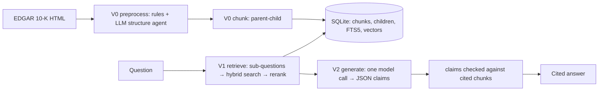

# 10k-agent

**Grounded, cited answers over SEC 10-K filings, built one tested version at a time.** Ask a question about the companies' annual reports; it finds the passages, answers from them alone with every number tied to the chunk it came from, checks each number against that chunk, and declines when the filings can't answer.

```text
$ tenk ask "What were Apple's total net sales in fiscal 2025?"

Chunks (8)
   1. AAPL-FY2025-7-016  AAPL FY2025 item 7 table p.23
   2. AAPL-FY2025-8-071  AAPL FY2025 item 8 table p.48
   3. AAPL-FY2025-8-002  AAPL FY2025 item 8 table p.29
   …

Answer

Apple's total net sales for fiscal 2025 were $416,161 million.

Claims (1)
  [1] verified   Apple's total net sales for fiscal 2025 were $416,161 million. = 416161 USD millions
       cites AAPL-FY2025-8-002 · found '416,161' in AAPL-FY2025-8-002
```
*A real run, abridged (here with gpt-oss-20b on vLLM; the default model is Qwen3.6-27B): the answer cites the income statement chunk, and the check found the number in it.*

## Pipeline



Each version adds one stage and was tested on its own before the next was built.

| Version | Adds | Results |
|---|---|---|
| **V0 · Parsing and chunking** | 10-K HTML → blocks (rules) → labels (LLM structure agent, validated and repaired) → one structured document → chunks, three ways | [Rule-based and parent-child level](experiments/V0_PARSING_CHUNKING.md): ~93% exact heading paths, every risk factor on its own |
| **V1 · Retrieval** | Sub-questions per company and filing → keyword + dense → RRF → rerank → round-robin. No LLM | [Parent-child best](experiments/V1_RETRIEVAL.md): Recall@5 87.3%, MRR 0.758 |
| **V2 · Generation** | One model call over V1's top 8 → JSON answer with claims citing chunk IDs → each claim checked | [21 / 30 number questions right](experiments/V2_GENERATION.md), 8 / 8 declines, every numeric claim grounded |
| **V3 · Agent** | The model drives: search, read sections, calculate, XBRL facts and EDGAR metadata (LangGraph) → V2's JSON answer and claim check | [90.0–91.5% of number and decline questions right vs V2's 71.7%](experiments/V3_AGENT.md) on 78 questions; the gain is tool use, not the SEC data |

V4–V6 (verified agent, model comparison, fine-tuning) and the first V3 were built on an earlier V0–V2 and are kept in [`archive/`](archive/README.md) as references for rebuilding them on this pipeline.

**Corpus:** Apple, Microsoft, Amazon, Alphabet, Meta, NVIDIA, Tesla, Netflix × fiscal years 2023–2025 (24 10-Ks); built and tested so far: the FY2025 filings of AAPL, AMZN, MSFT and NVDA. **Rules:** every number comes from a cited passage, never from the model's memory; unverifiable claims are shown as unverified, not hidden; no stock prices, forecasts or investment advice ([guarantees](docs/ARCHITECTURE.md#scope-and-guarantees)).

## Quickstart

Linux or macOS, Python 3.12 + [uv](https://docs.astral.sh/uv/), a ~40 GB GPU for the default 27B model ([all requirements](docs/GETTING_STARTED.md#requirements)).

```bash
git clone <this repo> && cd 10k-agent
uv sync --extra local --extra chunking
export SEC_USER_AGENT="Your Name you@example.com"
uv run tenk fetch                                    # 24 10-Ks from EDGAR (cached)
scripts/serve_vllm.sh qwen3.6-27b-fp8                # the default model, other terminal
taskset -c 16-31 uv run tenk build --stage chunk     # V0 on every filing (~35–60 min each)
taskset -c 16-31 uv run tenk build --stage load --stage embed
uv run tenk ask "What were Apple's total net sales in fiscal 2025?"
```

Full steps, the experiments, and troubleshooting: [Getting started](docs/GETTING_STARTED.md).

## Documentation

| Doc | For |
|---|---|
| [Getting started](docs/GETTING_STARTED.md) | Install, build the corpus, ask, run the experiments |
| [Serving](docs/SERVING.md) | The model layer and vLLM presets |
| [Architecture](docs/ARCHITECTURE.md) | Scope and guarantees, the pipeline, the repository layout |
| [Stage specs](docs/stages/) | V0–V3: data, knobs, outputs, how each works |
| [Decisions & issues](docs/DECISIONS.md) | Why things are the way they are, known issues |
| [Experiments](experiments/README.md) | Each version's design, metrics and results |
| [Contributing](CONTRIBUTING.md) | Checks, rules, commit style |
