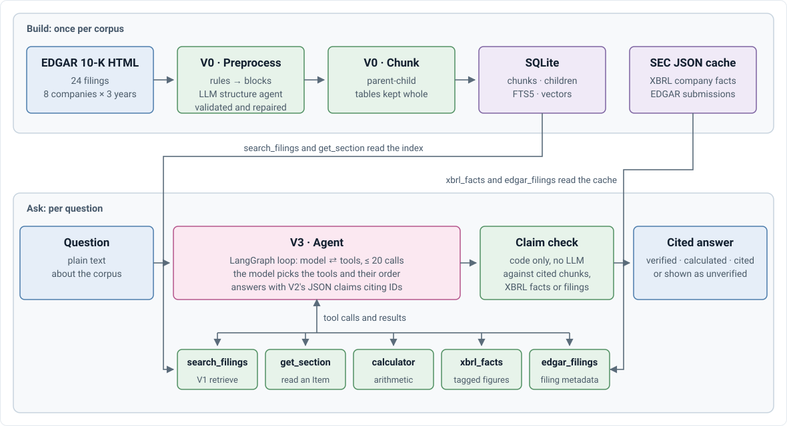
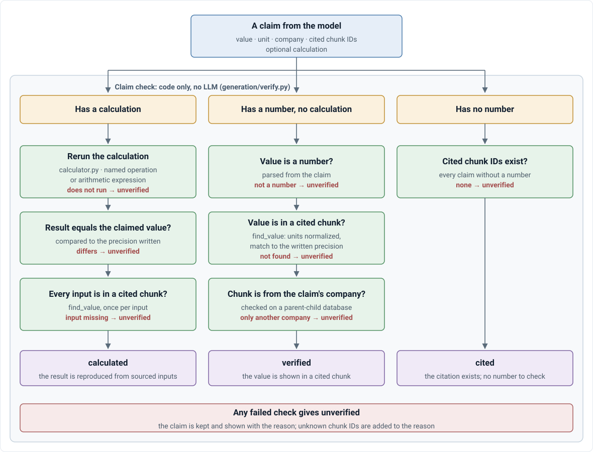

# Architecture

What the system does, what it guarantees, and how it is put together. There are two corpora: **V3**, cited answers about 10-Ks (most of this page), and **V4**, a junior sell-side research agent over eight marketplaces ([V4 below](#v4-research-agent)). To run it: [GETTING_STARTED.md](GETTING_STARTED.md).

## Scope and guarantees

**V3.** Questions about the annual reports (10-Ks) of a fixed corpus, answered from the filings alone. V4's guarantees differ: see [below](#v4-research-agent).

| Guarantee | How it is kept |
|---|---|
| Every number comes from a cited passage, never from the model's memory | The prompt requires it; each claim is then checked against the chunks (or the XBRL facts) it cites ([generation spec](stages/V2_GENERATION.md#how-it-works), [D-036](DECISIONS.md#d-036)) |
| Fiscal years come from filing metadata, never from text | `filings.fiscal_year` from the XBRL cover page ([D-004](DECISIONS.md#d-004)) |
| Unverifiable claims are shown as unverified, not hidden | Claim status `unverified`, with the reason |
| Questions outside the corpus are declined | `abstained: true` and a scope notice |
| No stock prices, forecasts or investment advice (V3) | Declined by the prompt ([D-001](DECISIONS.md#d-001)); V4 allows them as labeled drafts ([D-038](DECISIONS.md#d-038)) |

**V3 corpus** (`companies-v3.yaml`, kept as a regression check). Apple, Microsoft, Amazon, Alphabet, Meta, NVIDIA, Tesla, Netflix × fiscal years 2023–2025 (24 10-Ks), chosen because their fiscal years end in different months: "NVIDIA's revenue in 2024" is mostly its fiscal 2025 ([D-001](DECISIONS.md#d-001)). Built and tested so far: the FY2025 filings of AAPL, AMZN, MSFT and NVDA.

**Out of scope (V3).** Prices, forecasts, advice ([D-001](DECISIONS.md#d-001)); a public deployment ([D-023](DECISIONS.md#d-023)); verification-by-tools, model comparison and fine-tuning.

## Pipeline

  

The system was built in stages (the V0–V3 experiments), each tested on its own before the next was built. The specs and experiment reports keep those names.

| Component | Does | Spec | Experiment and results |
|---|---|---|---|
| **Parsing and chunking** | 10-K HTML → blocks (rules) → labels (LLM structure agent, validated and repaired) → one structured document → chunks, three ways | [spec](stages/V0_PARSING_CHUNKING.md) | [V0](../experiments/V0_PARSING_CHUNKING.md): rule-based and parent-child level (~93% exact heading paths, every risk factor on its own) |
| **Retrieval (`search_filings`)** | Sub-questions per company and filing → keyword + dense → RRF → rerank → round-robin. No LLM | [spec](stages/V1_RETRIEVAL.md) | [V1](../experiments/V1_RETRIEVAL.md): parent-child best, Recall@5 87.3%, MRR 0.758 |
| **Generation and claim check** | JSON answer with claims citing chunk IDs → each claim checked | [spec](stages/V2_GENERATION.md) | [V2](../experiments/V2_GENERATION.md): 21 / 30 number questions right, 8 / 8 declines, every numeric claim grounded (one call over the top 8 chunks, no tools) |
| **Agent** | The model drives: search, calculate, XBRL facts and EDGAR metadata (LangGraph) → JSON answer and claim check | [spec](stages/V3_AGENT.md) | [V3](../experiments/V3_AGENT.md): 88.5% (10-K tools) and 87.2% (+ SEC data) of 78 questions right vs V2's 66.7% |

Each stage spec covers: data, knobs, outputs, how it works, gotchas.

### Zoom in: the search_filings tool

The [pipeline](#pipeline)'s **Preprocess**, **Chunk** and **SQLite** blocks and its **search_filings** tool, opened up (dashed frames carry the pipeline's block names). The build runs once; the tool runs on every call the agent makes and returns chunks the agent can cite. The tool is the V1 retrieval, with one addition: companies and fiscal years the agent passes replace those found in the query, and a search that names no company returns an error asking for one instead of searching the whole corpus.

  

### Zoom in: claim check

The pipeline's **Claim check** block, opened up. Each claim the model returns is checked on its own, with code only (`generation/verify.py`, run inside `generate()`):

  

Evaluation does not run this check; it reads the statuses (below). An unknown chunk ID is added to the reason whatever the status. Unverified claims are shown to the user with the reason, not hidden.

## V4: research agent

Spec: [JUNIOR_SELL_SIDE_EQUITY_RESEARCH_AGENT_SPEC.md](JUNIOR_SELL_SIDE_EQUITY_RESEARCH_AGENT_SPEC.md). Design and build log: [V4_TECHNICAL_DESIGN_DOC.md](V4_TECHNICAL_DESIGN_DOC.md). Results: [V4_RESULTS.md](V4_RESULTS.md). Scope: [D-038](DECISIONS.md#d-038).

**Corpus** (`companies.yaml`, data in `data/v4/`). BKNG, EXPE, ABNB, TRIP (travel) and UBER, LYFT, DASH, CART (mobility and delivery). Sources: 10-K, 10-Q, 8-K Item 2.02 releases, XBRL, Form 4, Tiingo prices, FRED macro, Damodaran ERP, NYC TLC and BTS cross-checks. From Q1 2023 on.

| Guarantee | How it is kept |
|---|---|
| Every run has an as-of date; it sees only inputs filed strictly before it | `AsOf` (`asof.py`); every dated `Store` read takes it; a leak test |
| The LLM never outputs a forecast, valuation or rating number | Deterministic code computes them; the LLM extracts KPIs, proposes bounded assumptions and writes prose |
| Every figure in a note traces to the evidence log | Number trace after writing; one repair turn, then any sentence that still holds an untraced figure is dropped and logged |
| Ratings and price targets are drafts | Saved as `draft`; `tenk research approve` marks a version reviewed; labeled "not investment advice" |

**Modes.**

| Mode | Does | Runs as |
|---|---|---|
| **Ask** | Cited answer about reported data | Agent with the V4 tool groups (`prompts/ask.md`); `experiments/v4/ask_run.py` |
| **Research** | Answer computed from the model (forecast, scenario, valuation, peers) | Agent + model tools (`prompts/research.md`); `experiments/v4/research_run.py` |
| **Report** | Ten-section note, workbook, evidence and exception log | `tenk research report TICKER --as-of D` (S1–S11, `research/pipeline.py`) |

**Report pipeline.** Data pack → events (sub-agent) → three-statement model and integrity checks (a FAIL stops) → assumptions (defaults or bounded LLM proposer) → forecast to 2027Q4 with scenarios → peers' default models → valuation (peer multiple + DCF, PT, rating) → revisions vs the parent version → debates (sub-agents) → note prose with number trace → export (`note.md`, `note.pdf`, `workbook.xlsx` with live formulas checked for parity in LibreOffice). Output: `output/reports/<TICKER>/<as_of>/`, versioned in `model_versions`.

**Evaluation.** Five layers (extraction, model integrity, walk-forward backtest, valuation, note) plus the Ask and Research gold sets; `evaluation/extraction.py`, `backtest.py`, `note_eval.py`.

## Evaluation (V0–V3)

Evaluation never runs the pipeline, including the claim check. It takes the pipeline's output, the generated answer with its claim statuses and the chunks the model was shown, and grades it against the gold set. The only LLM in it is the judge, and only for text answers.

  

| Step | Code | LLM? |
|---|---|---|
| Gold chunks | `gold.resolve_evidence`, `retrieval_metrics.gold_chunks` | No |
| Number questions, declines | `scoring.grade`, `answer_metrics` | No |
| Text questions | `judge.py`, then `scoring.correct` again (`experiments/v2/judge.py`) | **Yes** |
| Aggregate and report | `scoring.summarize`, `report.build_report` | No |

`correct` does not depend on the claim statuses. A number that is in the answer text counts even if its claim is `unverified`; the claim statuses are reported as the grounded count.

## Design principles

| Area | Principle |
|---|---|
| Code | Pipeline code in `src/tenk_agent/`; experiments only run and score it |
| Settings | Every knob in `config.yaml`, per stage ([D-019](DECISIONS.md#d-019)); V4 adds `companies.yaml` (coverage) and `research.yaml` (forecast, valuation, proposer); experiments pin their own copy |
| Prompts | One Markdown file per task in `prompts/`, its output schema beside it |
| Storage | One SQLite file (tables, FTS5, sqlite-vec), reached only through `Store` ([D-005](DECISIONS.md#d-005)) |
| Models | One interface (`Model.complete`); open models on vLLM by default, Claude optional ([D-013](DECISIONS.md#d-013), [D-029](DECISIONS.md#d-029), [SERVING.md](SERVING.md)) |
| Evaluation | Gold sets first, evidence stored as verbatim quotes so re-chunking never invalidates them ([D-006](DECISIONS.md#d-006)) |

## Repository

| Path | Contents |
|---|---|
| `src/tenk_agent/` | Shared: `config`, `corpus` (the companies and years, from `companies.yaml`), `asof` (V4 as-of date), `store` (SQLite), `models`, `build` (the corpus build), `cli` |
| `src/tenk_agent/acquisition/` | `tenk fetch`: filings from SEC EDGAR (`edgar`, `filings`), with `raw/manifest.json`; V4: `companies` (verify), `market` (prices, macro, ERP), `crosscheck` (TLC, BTS), `insiders` (Form 4) |
| `src/tenk_agent/preprocess/` | Step 1 `blocks` (rules), step 2 `structure` (the LLM agent, assembly) and its `validation` rules; V4: `forms` (10-K, 10-Q, release) and `rules` (rule-based Items, [D-039](DECISIONS.md#d-039)) |
| `src/tenk_agent/chunking/` | `rule_based`, `parent_child`, `agentic`, and what they share (`common`) |
| `src/tenk_agent/retrieval/` | `index` (database, vectors), `decompose`, `search`, `embeddings` (embedder, reranker) |
| `src/tenk_agent/generation/` | `generate`, `answers`, `verify`, `calculator` |
| `src/tenk_agent/agent/` | `loop` (LangGraph), `tools` (tool groups and sets: V3, Ask, Research), `sec` (XBRL facts, EDGAR metadata, cached) |
| `src/tenk_agent/facts/` | V4: XBRL facts and quarters (`xbrl`, `quarters`), KPI and guidance extraction (`extract`, LLM; `rules`, ablation), `kpis.yaml`, `metrics.yaml` |
| `src/tenk_agent/research/` | V4: `refs` and `book` (citable ids), `datapack`, `model/` (DSL, graph, templates, checks), `propose`, `forecast`, `valuation`, `subagents` (events, debates), `note/`, `export/` (workbook, PDF), `pipeline` (Report mode) |
| `src/tenk_agent/evaluation/` | Gold sets (`gold`, `render`), retrieval metrics, number matching, the LLM judge, `scoring`, `report`; V4: `extraction`, `backtest`, `note_eval` |
| `src/tenk_agent/prompts/` | Every LLM prompt, one Markdown file per task, its output schema beside it: `structure.md` + `structure.schema.json`, `answer.md`, `agent.md`, `judge.md`; V4: `ask.md`, `research.md`, `extract.md`, `propose.md`, `events.md`, `debates.md`, `section.md` |
| `experiments/` | One folder per experiment (V0–V4): its runner and config; `V*.md` design and results (V4's are in `docs/`) |
| `evaluation/` | `gold/`: the reviewed gold question sets (JSONL, plus review PDFs); `results/<run>/`: each run's end-to-end report (`tenk report`). The code that loads, scores and reports is `src/tenk_agent/evaluation/` |
| `docs/` | This documentation |
| `scripts/` | `serve_vllm.sh` (open models) |
| `config.yaml` | Every setting for the CLI, per stage |
| `companies.yaml`, `companies-v3.yaml`, `research.yaml` | V4 coverage, V3 coverage, V4 forecast and valuation knobs |
| `data/`, `output/` | Filings, work files, databases; experiment outputs (generated, git-ignored) |
| `tests/` | Unit tests, no GPU or model |

## Documentation map

| You want | Read |
|---|---|
| What it is, a demo | [README](../README.md) |
| To install and run it | [GETTING_STARTED.md](GETTING_STARTED.md), [SERVING.md](SERVING.md) |
| How a stage works, its knobs and data | [stages/](stages/) |
| Why it is this way, known issues | [DECISIONS.md](DECISIONS.md) |
| How well it works | [experiments/](../experiments/README.md) (V0–V3), [V4_RESULTS.md](V4_RESULTS.md) |
| The V4 model equations and parameters | [FINANCIAL_MODELING.md](FINANCIAL_MODELING.md) |
| The V4 research agent | [spec](JUNIOR_SELL_SIDE_EQUITY_RESEARCH_AGENT_SPEC.md), [design](V4_TECHNICAL_DESIGN_DOC.md) |
| To contribute | [CONTRIBUTING.md](../CONTRIBUTING.md) |
