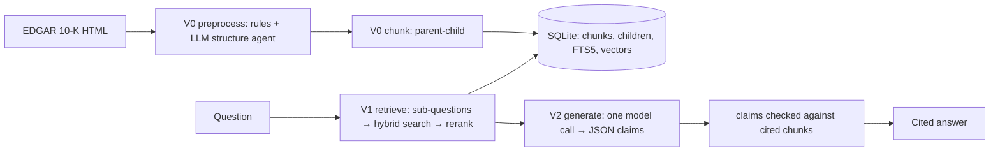

# Architecture

What the system does, what it guarantees, and how it is put together. To run it: [GETTING_STARTED.md](GETTING_STARTED.md).

## Scope and guarantees

Questions about the annual reports (10-Ks) of a fixed corpus, answered from the filings alone.

| Guarantee | How it is kept |
|---|---|
| Every number comes from a cited passage, never from the model's memory | The prompt requires it; each claim is then checked against the chunks it cites ([V2](stages/V2_GENERATION.md#how-it-works)) |
| Fiscal years come from filing metadata, never from text | `filings.fiscal_year` from the XBRL cover page ([D-004](DECISIONS.md#d-004)) |
| Unverifiable claims are shown as unverified, not hidden | Claim status `unverified`, with the reason ([D-015 in the archive](../archive/docs/DECISIONS.md#d-015)) |
| Questions outside the corpus are declined | `abstained: true` and a scope notice |
| No stock prices, forecasts or investment advice | Declined by the prompt ([D-009](DECISIONS.md#d-009)) |

**Corpus.** Apple, Microsoft, Amazon, Alphabet, Meta, NVIDIA, Tesla, Netflix × fiscal years 2023–2025 (24 10-Ks), chosen because their fiscal years end in different months: "NVIDIA's revenue in 2024" is mostly its fiscal 2025 ([D-001](DECISIONS.md#d-001)). Built and tested so far: the FY2025 filings of AAPL, AMZN, MSFT and NVDA.

**Out of scope.** Prices, forecasts, advice ([D-009](DECISIONS.md#d-009)); a public deployment ([D-023](DECISIONS.md#d-023)); the agent, verification-by-tools, model comparison and fine-tuning of V3–V6, kept in [`archive/`](../archive/README.md).

## Pipeline

Each version adds one stage and was tested on its own before the next was built.

| Stage | Adds | Spec | Experiment and results |
|---|---|---|---|
| **V0 · Parsing and chunking** | 10-K HTML → blocks (rules) → labels (LLM structure agent, validated and repaired) → one structured document → chunks, three ways | [V0_PARSING_CHUNKING.md](stages/V0_PARSING_CHUNKING.md) | [V0](../experiments/V0_PARSING_CHUNKING.md): rule-based and parent-child level (~93% exact heading paths, every risk factor on its own) |
| **V1 · Retrieval** | Sub-questions per company and filing → keyword + dense → RRF → rerank → round-robin. No LLM | [V1_RETRIEVAL.md](stages/V1_RETRIEVAL.md) | [V1](../experiments/V1_RETRIEVAL.md): parent-child best, Recall@5 87.3%, MRR 0.758 |
| **V2 · Generation** | One model call over V1's top 8 → JSON answer with claims citing chunk IDs → each claim checked | [V2_GENERATION.md](stages/V2_GENERATION.md) | [V2](../experiments/V2_GENERATION.md): 21 / 30 number questions right, 8 / 8 declines, every numeric claim grounded |

Each stage spec covers: data, knobs, outputs, how it works, gotchas.

## Design principles

| Area | Principle |
|---|---|
| Code | Pipeline code in `src/tenk_agent/`; experiments only run and score it |
| Settings | Every knob in `config.yaml`, per stage ([D-019](DECISIONS.md#d-019)); experiments pin their own copy |
| Prompts | One Markdown file per task in `prompts/`, its output schema beside it |
| Storage | One SQLite file (tables, FTS5, sqlite-vec), reached only through `Store` ([D-005](DECISIONS.md#d-005)) |
| Models | One interface (`Model.complete`); open models on vLLM by default, Claude optional ([D-013](DECISIONS.md#d-013), [D-029](DECISIONS.md#d-029), [SERVING.md](SERVING.md)) |
| Evaluation | Gold sets first, evidence stored as verbatim quotes so re-chunking never invalidates them ([D-006](DECISIONS.md#d-006)) |

## Repository

| Path | Contents |
|---|---|
| `src/tenk_agent/` | Shared: `config`, `corpus` (the companies and years), `store` (SQLite), `models`, `build` (the corpus build), `cli` |
| `src/tenk_agent/acquisition/` | `tenk fetch`: the corpus 10-Ks from SEC EDGAR (`edgar`), with `raw/manifest.json` |
| `src/tenk_agent/preprocess/` | V0 step 1 `blocks` (rules), step 2 `structure` (the LLM agent, assembly) and its `validation` rules |
| `src/tenk_agent/chunking/` | V0 `rule_based`, `parent_child`, `agentic`, and what they share (`common`) |
| `src/tenk_agent/retrieval/` | V1 `index` (database, vectors), `decompose`, `search`, `embeddings` (embedder, reranker) |
| `src/tenk_agent/generation/` | V2 `generate`, `answers`, `verify`, `calculator` |
| `src/tenk_agent/evaluation/` | Gold sets (`gold`, `render`), retrieval metrics, number scoring, the LLM judge |
| `src/tenk_agent/prompts/` | Every LLM prompt, one Markdown file per task, its output schema beside it: `structure.md` + `structure.schema.json`, `answer.md`, `judge.md` |
| `experiments/` | One folder per version: its runner, scoring, config and test data; `V*.md` design and results |
| `archive/` | V3–V6, for reference only |
| `docs/` | This documentation |
| `scripts/` | `serve_vllm.sh` (open models) |
| `config.yaml` | Every setting for the CLI, per stage |
| `data/`, `output/` | Filings, work files, databases; experiment outputs (generated, git-ignored) |
| `tests/` | Unit tests, no GPU or model |

## Documentation map

| You want | Read |
|---|---|
| What it is, a demo | [README](../README.md) |
| To install and run it | [GETTING_STARTED.md](GETTING_STARTED.md), [SERVING.md](SERVING.md) |
| How a stage works, its knobs and data | [stages/](stages/) |
| Why it is this way, known issues | [DECISIONS.md](DECISIONS.md) |
| How well it works | [experiments/](../experiments/README.md) |
| To contribute | [CONTRIBUTING.md](../CONTRIBUTING.md) |
