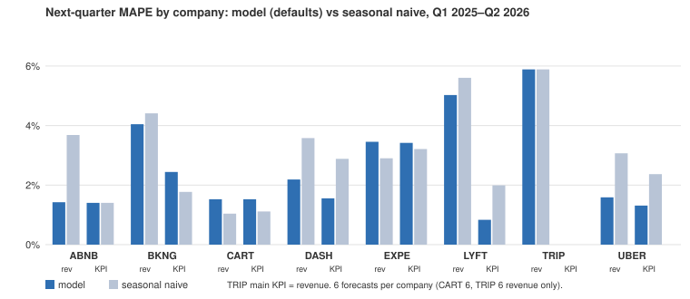

# V4 results: junior sell-side research agent

Eight online marketplaces (UBER, LYFT, DASH, CART, BKNG, EXPE, ABNB, TRIP), Q1 2023 to Q2 2026, every input read as of a date (filed strictly before it). Local model Qwen3.6-27B (FP8, vLLM); judge gpt-oss-20b. Bars were frozen before the first run of each phase (design doc §13.1); a miss is reported as a miss. Build log and every decision: `docs/V4_TECHNICAL_DESIGN_DOC.md` §17.

## Results by layer

| Layer | Test | Bar | Result | |
|---|---|---|---|---|
| 1. Extraction | 337 hand-checked labels, 32 releases, all eight | ≥ 98% exact; 100% on revenue, EPS, main KPI | **98.5% exact, 100% critical** | pass |
| 2. Model integrity | balance (two ways), quarters sum, Q4 ties, take rate, segments sum, no future input, formula-only; workbook parity | 100% | **all eight pass** at three as-ofs; every formula cell recalculates to Python's value in LibreOffice | pass |
| 3. Forecast | walk-forward, 90 next-quarter forecasts (Q1 2025–Q2 2026) | MAPE below seasonal naive on revenue and main KPI; bias near zero | revenue **3.14% vs 3.77%**, main KPI **2.30% vs 2.58%**; bias −0.15% / −0.23% (Wilcoxon p 0.15 / 0.71) | pass (not significant) |
| 4. Valuation | identical inputs; WACC monotonicity; peer range | byte-identical; PT falls as WACC rises; multiples inside the peer range or flagged | **byte-identical for all eight; monotone wherever the DCF is meaningful; all inside or flagged** | pass |
| 5. Note | ten sections, number trace, seeded errors, rubric | 100% traced; rubric ≥ 4/5; every seeded error caught | UBER: **100% traced, 60/60 seeded, rubric 4.2**; BKNG: 100% traced, 60/60 seeded, **rubric 3.8 then 3.4** | UBER pass, **BKNG miss** |
| Ask | 79 questions | ≥ 85% correct and verified; 100% of cited ids resolve | **89.9%, 100%** (run 4, after the user's gold rulings; run 3 on the original gold: 84.8%) | pass |
| Research | 72 questions | ≥ 90% pass (model: ref, assumptions, no unverified claim); 100% of forward numbers from model tools | **88.9%, 100%** (run 2, with two scoring corrections the user adopted after run 1; 87.5% / 94.6% as first frozen) | **miss** |

## Backtest

| Run (90 forecasts unless noted) | Revenue MAPE | Main KPI MAPE | Revenue / KPI bias | Wilcoxon p |
|---|---|---|---|---|
| **model, defaults** | **3.14%** | **2.30%** | −0.15% / −0.23% | 0.145 / 0.706 |
| seasonal naive | 3.77% | 2.58% | +0.64% / +0.17% | |
| guidance midpoint (where guided: 13 revenue, 31 KPI) | 2.54% | 1.64% | | |
| plain LLM, no tools | 56.3% (all) | | | |
| ablation: guidance high end | 3.00% | 2.01% | +0.68% / +0.50% | **0.011 / 0.011** |
| ablation: LLM proposer | 3.78% | 2.90% | +1.09% / +0.39% | 0.600 / 0.315 |
| ablation: fitted fade | = defaults (next quarter uses only the starting rate) | | | |
| long horizon (2025 from Feb 2025, 32), fixed / fitted fade | 4.03% / 3.29% | 4.18% / 3.73% | | naive 4.18% / 3.38% |

Guidance: companies beat their own guided midpoint 43 times in 44. Extraction ablation: rules 31.5% exact (KPIs 47.7%, guidance not attempted) vs the LLM's 98.5%. Cross-check ablation: not run, because at every forecast date no month of the target quarter's TLC (or BTS) data was public yet; these series confirm a reported quarter, they cannot forecast the next.

## Ratings, as of 2026-09-01 (`--all`)

| | Price | 12-month PT | Return | Absolute | Relative |
|---|---|---|---|---|---|
| LYFT | $16.90 | $28.50 | +68.6% | Buy | Buy |
| TRIP | $9.52 | $15.76 | +65.6% | Buy | Buy |
| EXPE | $317.12 | $452.82 | +42.8% | Buy | Hold |
| CART | $50.52 | $71.53 | +41.6% | Buy | Hold |
| UBER | $75.65 | $82.69 | +9.3% | Hold | Hold |
| BKNG | $199.09 | $150.47 | −24.4% | Sell | Hold |
| ABNB | $183.22 | $96.76 | −47.2% | Sell | Sell |
| DASH | $231.74 | $111.98 | −51.7% | Sell | Sell |

Drafts for education and testing, not investment advice. Read the limits before reading these.

## Example report

UBER, earnings update after Q2 2026, as of 2026-08-06: [note (Markdown)](examples/UBER-2026-08-06-note.md), [note (PDF)](examples/UBER-2026-08-06-note.pdf), [model-change workbook](examples/UBER-2026-08-06-workbook.xlsx). Ten sections, 100% of figures traced to the evidence log, every model cell a live formula.

## Limits

- **Small sample.** 90 next-quarter forecasts over six quarters; neither gate difference vs seasonal naive is statistically significant. The year-ahead forecast is worse than naive on the main KPI.
- **Possible leakage.** The LLM's training cutoff is not published, so no quarter can be called held out. Two probes found none: every forecast's inputs were filed before its date, and the no-tools LLM is far off (56% MAPE).
- **Valuation mechanics drive the ratings.** The target multiple is the sector peers' median of our own 2027E EV/EBITDA, so a company priced well above its peers (DASH, ABNB) gets a large Sell and a cheap one (LYFT) a large Buy; only three peers per sector. TRIP's DCF is negative (continuing-operations FCF), so its PT rests on a multiple of a thin EBITDA.
- **Forecast defaults miss structural breaks.** UBER's 2026 UK move to agent enters as the last y/y change and lifts its 2027E margin to 23.9%; the LLM proposer, meant to catch such breaks, hurt accuracy on the backtest.
- **No paid data.** No consensus estimates; prices from Tiingo's free tier (internal use only); companies' own KPI definitions differ.
- **Cross-checks are narrow.** TLC covers New York City only (a directional check on Uber and Lyft); BTS is all US airlines, with publish dates estimated (month + 90 days).
- **Gold sets are not human-reviewed.** Ask (79) and Research (72) questions were drafted by the agent and checked by script; extraction labels were cross-checked by independent methods, not by a person. The Ask set's NYC-trips decline question is now answerable (TLC loaded in V4.7) and needs updating.
- **Judge noise.** The note rubric moved 3.8 → 3.4 on near-identical text; no human sample has been scored.
- **XBRL gaps.** ABNB tags no D&A or capex (no FCF line); EPS and shares lack a three-month Q4; Q4 EPS comes from the release.

## Decisions (2026-10-28)

- Guidance anchor: the midpoint stays the default although the high end scored better (p = 0.011); a human review is pending.
- Research scoring: the two corrections (variance answers may cite the bridge's `var-` ids; claims citing only guidance are reported data) are adopted, after run 1, by the user.
- Qwen vs Claude on the LLM steps: not run, by the user's decision.
- Gold sets and a human rubric sample: to be reviewed by the user later.

## Roll-out: UBER end to end (2026-10-28)

`TENK_COMPANIES=companies.yaml tenk research report UBER --as-of 2026-08-06` (then `tenk research approve UBER:v1 --by <initials>` after review) ran all eleven steps on the Qwen 27B: 6 events, 3 debates, ten sections, saved as `UBER:v1` (draft), Buy, PT $83.62, workbook parity 750/750, 60/60 seeded errors caught. One figure in the debate prose ("20% constant currency") is not among that debate's facts; the writer kept it after its repair turn and it is logged as X-19 (error), so this note is not 100% traced. The example files above are this run.
