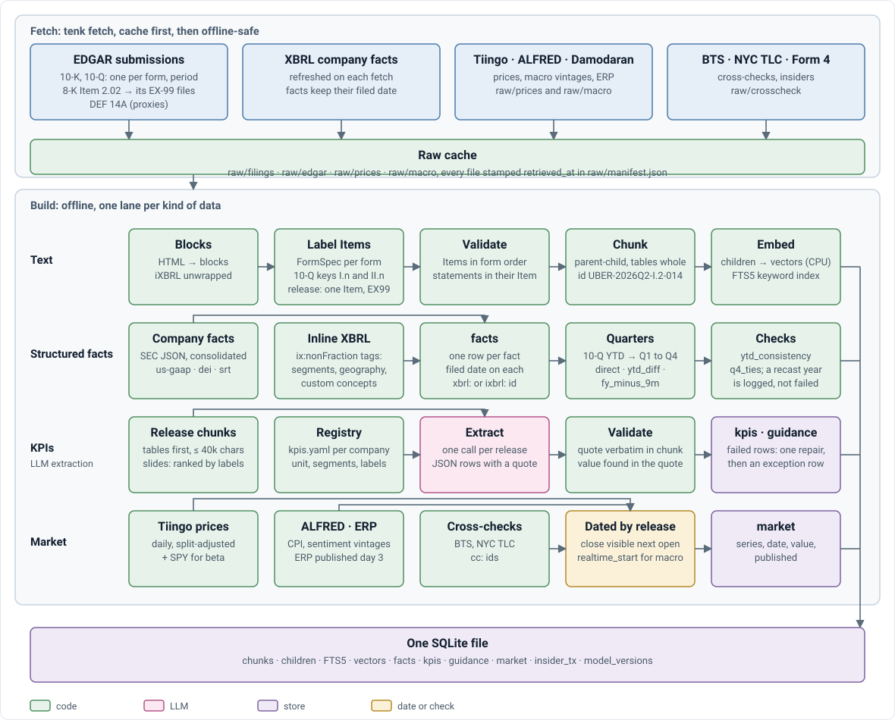
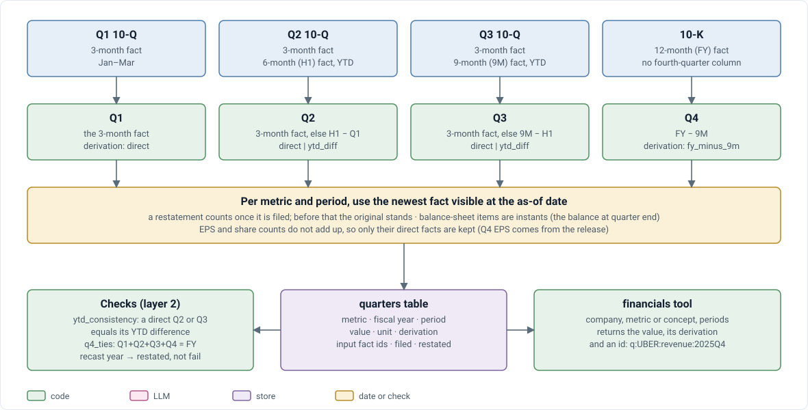
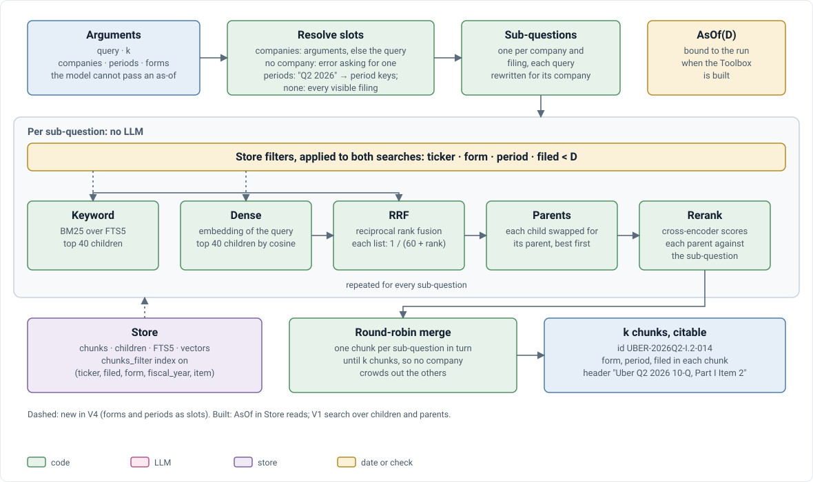
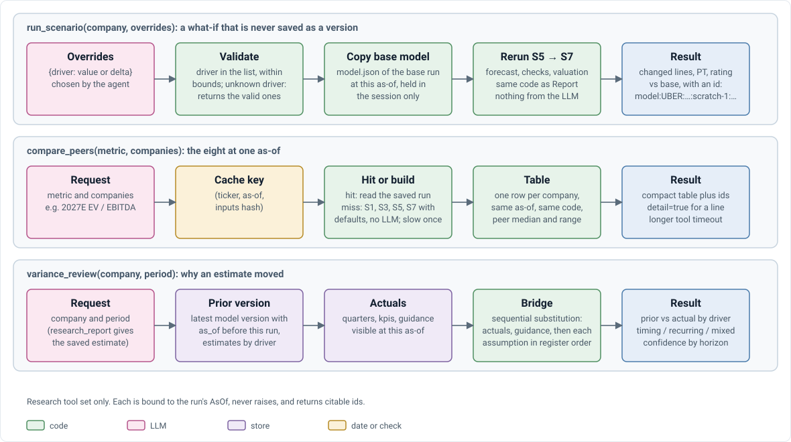
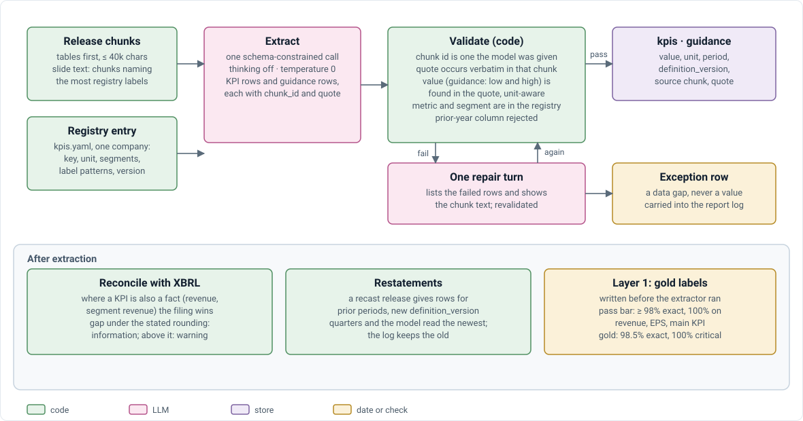
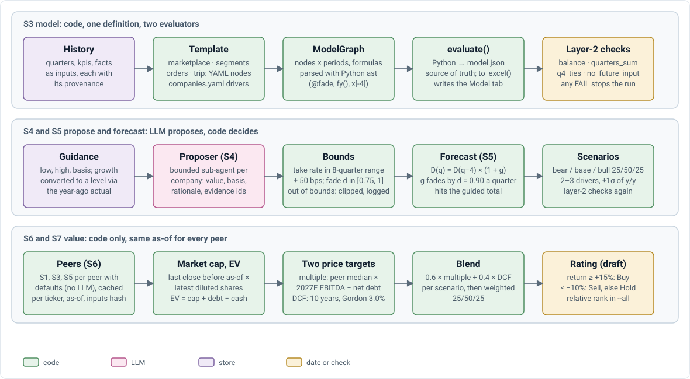
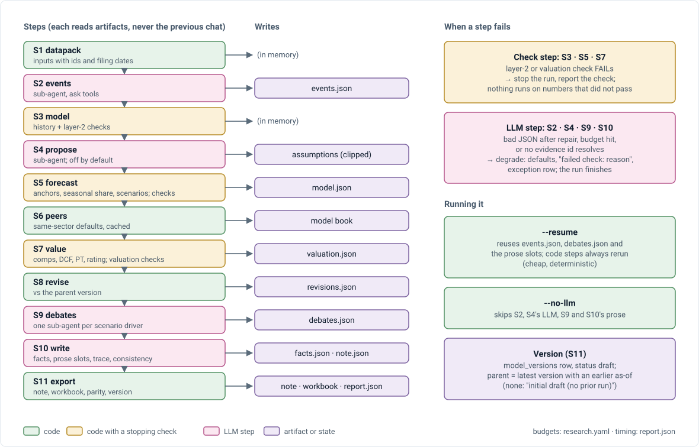
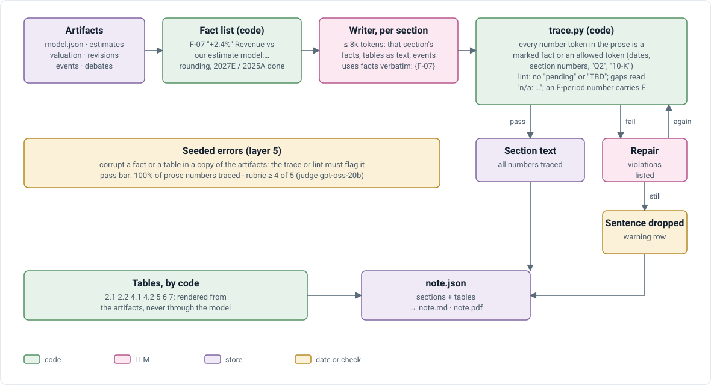

# V4 technical design: a junior sell-side research agent

**What this is:** how the V4 build works, as built. **Spec** (what to build): [JUNIOR_SELL_SIDE_EQUITY_RESEARCH_AGENT_SPEC.md](JUNIOR_SELL_SIDE_EQUITY_RESEARCH_AGENT_SPEC.md) ("spec §n"). **Why** each choice: [DECISIONS.md](DECISIONS.md) (D-nnn). **History** (phase gates, findings, gold runs): [V4_BUILD_LOG.md](V4_BUILD_LOG.md). **Numbers:** [V4_RESULTS.md](V4_RESULTS.md). **Model equations:** [FINANCIAL_MODELING.md](FINANCIAL_MODELING.md).
**Updated:** 2026-11-01. A bare "§n" is a section of this doc. What is not built is listed once, in §13.1.

**How to read it.** §2 is the map: every component and every interface between them, on one page. §3–§11 are deep dives, one per subsystem, each in the same order: **components → interfaces → behavior → failure handling → tests**. Each interface is defined once, in the section that owns it; §2.3 only points there. §12 follows one run across the interfaces with real payloads.

---

## 1. Overview

### 1.1 Goals

One agent covers eight US travel and mobility companies (BKNG, EXPE, ABNB, TRIP · UBER, LYFT, DASH, CART) from free public data (D-038), in three modes (spec §2):

| Mode | In | Out |
|---|---|---|
| **Ask** | a question + as-of | a short cited answer from filed data |
| **Research** | a question + as-of | an analytical answer computed by the model, assumptions shown |
| **Report** | ticker + as-of | a 10-section draft note, a model-change workbook, an evidence and exception log |

Every run takes an **as-of date** and sees only data published before it, which makes the walk-forward backtest possible. V4 replaces the V0–V3 corpus but reuses their pipeline (parsing, chunking, retrieval, agent loop, claim check); V3 stays runnable as a regression check ([build log §2](V4_BUILD_LOG.md#2-migration-from-v3)).

### 1.2 Principles

| Principle | Means | Where enforced |
|---|---|---|
| **As-of everywhere** | No read can see data published on or after the as-of | §2.5, `asof.py`, `Store` |
| **Code computes every number** | The LLM extracts, proposes bounded assumptions and writes prose; it never outputs a forecast or valuation number | §2.5, §7.6, §9.5 |
| **Everything is cited** | Every figure carries an id that resolves to its source | §9.2 |
| **Flag, don't hide** | A gap, conflict or failed check becomes an exception row, never an estimate shown as fact | §9.6 |
| **Degrade, don't stop, except on integrity** | A failed LLM step leaves "failed check: reason"; a model-integrity failure stops the run | §8.6 |
| **Artifacts, not transcripts** | Steps hand over JSON files, not chat history | §5.5, §8.2 |
| **One definition, two evaluators** | The model is defined once; Python and the workbook evaluate it and must agree | §7.3, D-041 |
| **Knobs in config** | Every default lives in a pinned YAML file | Appendix A, D-019 |

### 1.3 Glossary

| Term | Meaning |
|---|---|
| **as-of (D)** | The run date; the world as seen at the market open of D (US/Eastern) |
| **release** | 8-K Item 2.02 exhibit 99.x: earnings release or shareholder letter. Form key `ER` |
| **period key** | `2026Q2`, `FY2025` |
| **data pack** | S1's history: every model input with its citable id and filing date |
| **driver** | A model input the forecast grows or holds (volume, price per unit, segment bookings, take rate, cost share) |
| **assumption** | A named forecast knob (`gb_g_mobility.g0`, `take_rate_mobility.shift0`, `fade`), listed on the Assumptions tab |
| **anchor** | A guidance figure the forecast is solved to hit |
| **model book** | A session's models at one as-of, with their `model:` ids (`research/book.py`) |
| **version** | A saved Report run (`UBER:v2`) in `model_versions`, with its parent |
| **fact (F-n)** | A pre-formatted figure the note may print, with its source id |
| **evidence / exception (E-n / X-n)** | Rows of a report's log |
| **layers 1–5** | The spec's evaluation layers: extraction, model integrity, forecast, valuation, note |

---

## 2. System architecture

### 2.1 Component map

<p align="center">
  
</p>

Boxes are components (§2.2); numbered arrows are interfaces (§2.3). Pink marks a component that calls the LLM.

### 2.2 Components

| Component | Responsibility | Code | Owns (state) | Depends on | LLM |
|---|---|---|---|---|:-:|
| **Acquisition** | Fetch filings, XBRL, prices, macro, ERP, cross-checks, Form 4; cache them | `acquisition/` | `data/v4/raw/` + `manifest.json` | EDGAR, Tiingo, ALFRED, Damodaran, BTS, NYC TLC | |
| **Text processing** | Filings → blocks → Items → chunks → vectors | `preprocess/`, `chunking/`, `retrieval/index.py` | chunk and child rows, FTS5, vectors | raw cache | (rules, D-039) |
| **Facts and extraction** | XBRL and inline XBRL facts; quarters; KPI and guidance extraction from releases | `facts/` | `facts`, `kpis`, `guidance` rows; `kpis.yaml`, `metrics.yaml` | raw cache, chunks | ✓ |
| **Store** | One SQLite file; every read filtered by the run's `AsOf` | `store.py`, `asof.py` | the database (D-005) | | |
| **Retrieval** | Hybrid search over chunks: slots, BM25 + dense, fusion, rerank | `retrieval/` | | Store, embedder, reranker | |
| **Agent runtime** | Tool-calling loop, toolbox, prompts, budgets; Ask, Research and the bounded sub-agents | `agent/`, `research/subagents.py`, `research/propose.py`, `prompts/` | | Retrieval, Store, Model engine, LLM | ✓ |
| **Model engine** | Data pack, model graph, layer-2 checks, forecast, scenarios, valuation, model book | `research/datapack.py`, `research/model/`, `forecast.py`, `valuation.py`, `book.py` | `model.json`, `valuation.json` per run; the book cache per session | Store | |
| **Report pipeline** | Fixed steps S1–S11 per ticker and as-of; resume; versions | `research/pipeline.py`, `research/note/` | the report folder; a `model_versions` row | everything above | ✓ (S2, S4, S9, S10) |
| **Verification** | Reference grammar and resolver; claim check; number trace; consistency check | `research/refs.py`, `generation/verify.py`, `research/note/trace.py`, `research/note/consistency.py` | | Store, model book | |
| **Export** | `note.md`, `note.pdf`, `workbook.xlsx`; parity check | `research/export/`, `evaluation/render.py` | output files | Report artifacts, LibreOffice, headless Chrome | |
| **Evaluation** | Gold sets, scorers, backtest, note eval | `evaluation/`, `experiments/v4/` | `evaluation/gold/`, `evaluation/results/` | everything | ✓ judge |

### 2.3 Interface catalog

One row per boundary. The contract is defined in the owning section; this table is the index.

| # | Interface | Between | Form | Contract (owning section) |
|---|---|---|---|---|
| 1 | **Raw cache** | Acquisition → builders | files under `raw/`, `manifest.json` | layout, `retrieved_at` (§3.2) |
| 2 | **Store reads** | everything → SQLite | Python API on a `Store` bound to an `AsOf` | tables, as-of columns, read methods (§3.2) |
| 3 | **Search** | agents → Retrieval | `search_filings(query, companies, periods, forms, k)` | slots, result rows, chunk ids (§4.2) |
| 4 | **Tool calls** | agent ↔ toolbox | JSON-schema arguments in, JSON with ids out | tool sets, signatures, result rules (§5.2) |
| 5 | **LLM calls** | code ↔ model | system prompt + messages; JSON reply | per-call prompt, schema, budget (§5.2) |
| 6 | **Extraction rows** | extractor → Store | KPI and guidance rows with chunk id and quote | registry, row schema, validation (§6.2) |
| 7 | **Templates** | config → Model engine | YAML lines with DSL expressions | node kinds, DSL, anchors, scenarios (§7.2) |
| 8 | **Model and valuation files** | Model engine → Report, tools, Export | `model.json`, `valuation.json` | schemas (§7.2) |
| 9 | **Pipeline artifacts** | S1 … S11 | JSON files in the report folder | step I/O table (§8.2) |
| 10 | **Reference ids** | everywhere | strings | grammar and resolvers (§9.2) |
| 11 | **Fact list** | Report code → note writer | `{id, label, value, unit, source, period, filed}` | §9.3 |
| 12 | **Outputs** | system → reviewer | `note.md/.pdf`, `workbook.xlsx`, JSON files, version status | §10 |
| 13 | **Gold and results** | Evaluation ↔ files | JSONL gold, result folders | §11.2 |
| – | **Config** | everything | `config.yaml`, `companies.yaml`, `research.yaml`, `kpis.yaml`, `metrics.yaml`, templates | Appendix A |
| – | **CLI** | user → system | `tenk …`, `python -m …` | Appendix B |

### 2.4 Data flow and control flow

<p align="center">
  
</p>

**Build (offline):** `tenk fetch` → raw cache → `tenk build` stages: text (chunk, load, embed), facts (XBRL, inline XBRL), KPIs (LLM extraction), market (prices, macro, ERP, cross-checks). New filings are appended without a rebuild (`--stage append`).

**Run (per question or report, at one as-of):**

| Mode | Control | Path through the components | New numbers from |
|---|---|---|---|
| **Ask** | The agent picks tools (tool set `ask`) | loop → toolbox → Store, Retrieval, saved versions → claim check → answer | a calculator over reported figures |
| **Research** | The agent picks tools (tool set `research`) | as Ask, plus model tools → model book → Model engine | model tools only (`model:` ids) |
| **Report** | Code runs S1–S11; LLM calls are leaf tasks | pipeline → Model engine, sub-agents, writer → Verification → Export → `model_versions` | the Model engine only |

Ask and Research are one agent with two tool sets. Report is not an agent loop and never starts an Ask or Research run (spec §2.3). Ask and Research read a saved Report version back through `research_report` and `model:…:v<n>:…` ids.

### 2.5 Cross-cutting rules

**The as-of rule** (D-040). `AsOf(D)` is the world at the market open of D, US/Eastern. Data is visible when it became public **strictly before** D:

| Data | Visible when | Column |
|---|---|---|
| Filings (any form), their chunks, facts, KPIs, guidance | `filing_date < D` | `filed` |
| Tiingo close | `date < D` (as-of 2026-08-06 sees the 08-05 close) | `published` |
| FRED / ALFRED | observation date `< D`, and for revised series (CPI, UMCSENT, RSFSDP) vintage `realtime_start < D`; DGS10 counts as published the day after its date | `published` |
| Damodaran ERP | monthly file, published three days after the month starts | `published` |
| BTS, NYC TLC | publish date (BTS: month end + 90 days, estimated) | `published` |
| Our saved versions | `as_of < D` | `as_of` |

- `asof.py` (`AsOf.sees`, `.sql`, `.latest`) is the only code that compares dates for visibility.
- A `Store` is bound to one `AsOf` when opened, and every read filters through it, so no read path can skip it. V3 opens at `AsOf.today()`.
- No tool takes an as-of argument that widens the view (`research_report`'s `as_of` can only narrow it).
- **Restatements:** `.latest()` returns, per (concept, period), the value from the newest filing visible at D; an earlier as-of sees the original.
- Checked on every run by the layer-2 check `no_future_input` (§7.4) and on every backtest forecast by the leakage probe (§11.4). LLM memory is a separate leak, measured by the no-tools baseline (§11.4, D-043).

**The no-LLM-numbers rule.** LLM output reaches the numbers only as (a) extracted rows that code validates against a verbatim quote (§6.3), (b) bounded assumption proposals that code clips (§7.6), (c) prose in which every number is a marked fact (§9.5). Tables are written by code.

**Errors.** Tools never raise: a bad call returns `{"error": …}` for the model to read (§5.2). Report code steps raise on a failed integrity or valuation check and stop the run; LLM steps degrade (§8.6). Builders log every gap as an exception row, never a guessed value.

**Logging and trace.** Every number in an answer or note carries an id (§9.2). Agent runs keep their transcript and tool calls; `report.json` records each step's seconds, LLM calls and tokens (`timing`); `raw/manifest.json` records each file's `retrieved_at`.

---

## 3. Data layer

### 3.1 Components

| Component | Code | Does |
|---|---|---|
| Companies | `corpus.py`, `companies.yaml`, `acquisition/companies.py` | Coverage list, sectors, templates; `tenk companies verify` fills CIKs from SEC |
| EDGAR filings | `acquisition/edgar.py`, `acquisition/filings.py` | 10-K, 10-Q (one per form and period, amendments ignored), 8-K 2.02 exhibits `EX-99.*`, DEF 14A |
| Market | `acquisition/market.py` | Tiingo daily prices (+ SPY), ALFRED series, Damodaran ERP |
| Cross-checks, insiders | `acquisition/crosscheck.py`, `acquisition/insiders.py` | NYC TLC trips by license, BTS airline passengers; Form 4 |
| Text processing | `preprocess/forms.py`, `preprocess/rules.py`, `chunking/`, `retrieval/index.py` | Form-aware Items, parent-child chunks, vectors |
| Facts | `facts/xbrl.py`, `facts/quarters.py`, `facts/metrics.yaml` | Company facts + inline XBRL → `facts`; quarters derived on read |
| Store | `store.py`, `asof.py` | Schema, as-of-filtered reads |

### 3.2 Interfaces

**Raw cache** (`data/v4/raw/`): `filings/<T>/<period>-<form>/` (forms `10-K`, `10-Q`, `ER`, `DEF14A`), `edgar/<T>/companyfacts.json`, `prices/`, `macro/`, `crosscheck/`. Every file is stamped with `retrieved_at` in `raw/manifest.json`. Fetching is cache-first; builds run offline.

**`companies.yaml`** (pinned per experiment; `TENK_COMPANIES` selects it):

```yaml
UBER:
  name: Uber Technologies, Inc.
  cik: 1543151            # written by `tenk companies verify`, never typed
  sector: mobility        # peers = same sector
  template: segments      # §7.3
  main_kpi: gross_bookings
```

**Store schema** (one SQLite file, D-005), the interface everything above reads:

| Table | Holds | As-of column |
|---|---|---|
| `filings` | accession, ticker, form, fiscal year and period, period end, `filing_date`, `accepted_at`, source URL, `retrieved_at` | `filing_date` |
| `chunks`, `children` (+ FTS5, vectors) | text with `form`, `fiscal_period`, `filed` | `filed` |
| `facts` | ticker, taxonomy, concept, dims (JSON; `{}` = consolidated), start, end, value, unit, accession, form, fy, fp | `filed` |
| `kpis` | metric, segment, period, value, unit, `definition_version`, chunk id, quote, method (`llm`/`rules`) | `filed` |
| `guidance` | metric, target period, low, high, basis (`level`/`growth_yoy`/`margin`), chunk id, quote, issued in | `filed` |
| `market` | series key (prices, macro, ERP, cross-checks), date, value | `published` |
| `insider_tx` | Form 4 transactions | `filed` |
| `model_versions` | id, ticker, as_of, parent_id, inputs_hash, status (`draft`/`reviewed`), folder | `as_of` |

Quarters are **not stored**: `facts/quarters.py` derives them on read under the store's `AsOf`, so nothing goes stale between as-ofs. A saved version's numbers live in its folder's files (§8.2), not in tables.

**Store read API** (all as-of filtered): `search`, `vector_search`, `child_search`, `child_vector_search`, `get_chunk`, `chunks`, `filing(s)`, `facts`, `fact`, `kpis`, `guidance`, `series`, `insider_summary`, `model_versions`. Writes (`add_*`) happen at build time only, plus `add_model_version` (Report) and `set_version_status` (review).

### 3.3 Acquisition

- **EDGAR:** a User-Agent with an email, one request per 0.12 s (SEC allows 10/s). Releases are submissions rows with `form == "8-K"` and Item 2.02; the filing index gives every `EX-99.*` (a release can have two `EX-99.1`). A release's period is the last quarter end before it was filed, cross-checked against the 10-Q.
- **DEF 14A:** the first proxy each year (DEFC14A when contested), keyed to the prior fiscal year; text only, one pseudo-Item `PROXY`.
- **Prices:** Tiingo free plan, split-adjusted, internal use only (D-044).
- **Macro:** ALFRED vintages for revised series. **ERP:** Damodaran's monthly implied ERP.
- **Cross-checks:** NYC TLC Parquet aggregated at fetch to trips per month per license (HV0003 Uber, HV0005 Lyft); BTS T-100 monthly passengers.

<p align="center">
  
</p>

### 3.4 Text processing

`preprocess/forms.py` gives each form a `FormSpec` (Items in order, required Items, where statements live, key format); the rule-based structurer (`preprocess/rules.py`, D-039) labels blocks by it.

| Form | Items | Chunk id example |
|---|---|---|
| 10-K | as V0 (1, 1A, 7, 7A, 8, 15, …) | `UBER-FY2025-7-003` |
| 10-Q | per Part: `I.1`…`I.4`, `II.1`, `II.1A` | `UBER-2026Q2-I.2-014` |
| Release | one pseudo-Item `EX99`; tables whole (D-003) | `UBER-2026Q2-ER-EX99-005` |
| DEF 14A | one pseudo-Item `PROXY` | `UBER-FY2025-DEF14A-PROXY-012` |

Chunks are parent-child (V0); children are embedded on CPU when vLLM holds the GPU (I-002). Chunk headers name the form and period ("Uber Q2 2026 10-Q, Part I Item 2 MD&A").

### 3.5 Structured facts and quarters

<p align="center">
  
</p>

- **Company facts** has no dimensional facts and drops company-specific concepts, so `facts/xbrl.py` also reads each filing's inline XBRL for segments and custom concepts.
- **Quarters** (`facts/quarters.py`): ~90-day facts direct; Q2 = H1 − Q1 and Q3 = 9M − H1 when only year-to-date exists; Q4 = FY − 9M (spec §1.6). Instants need no derivation. EPS and share counts don't add up, so only direct facts are kept; Q4 EPS comes from the release.
- Within a fiscal year a metric uses one concept (`metrics.yaml` lists concepts in priority order, with per-company overrides).
- A year whose filings disagree because of a recast reads `restated` (logged), not `fail`.
- **Ids:** `xbrl:<T>:<tax>:<concept>:<accession>:<start>/<end>` for durations, `…:<end>` for instants; `q:<T>:<metric>:<period>` for a derived quarter.

### 3.6 Failure handling

| Failure | Handling |
|---|---|
| Source unreachable | Cached copy used; offline builds never fetch |
| Source blocks scripts | Dropped, never worked around (Stooq, TSA, Google Trends; [build log §3.5](V4_BUILD_LOG.md#35-other-data-sources-spec-8-item-5)) |
| Release period mismatches its 10-Q | Fetch error |
| Missing concept or quarter | Left blank; logged when the model reads it (§7.8) |
| Recast year | `restated`, logged |

### 3.7 Tests

`tests/test_asof.py` (V4 code must pass an `AsOf`; a filing on or after D yields zero rows), `test_facts.py` (quarter derivation, `q4_ties`), `test_store.py`, `test_filings_v4.py`, `test_market.py`, `test_acquisition.py`. V3 regression: `experiments/v4/v3_regress.py` (byte identity of the shared pipeline on the V3 corpus).

---

## 4. Retrieval

### 4.1 Components

V1's sub-question hybrid search (`retrieval/search.py` `SubQuestionRetriever`, `retrieval/decompose.py`, `retrieval/index.py`), run inside the store's as-of filter. No LLM. Stage spec: [V1_RETRIEVAL.md](stages/V1_RETRIEVAL.md).

### 4.2 Interfaces

```text
search_filings(query: str, companies?: [str], periods?: [str], forms?: [str], k?: int)
  companies   tickers or names; ["all"] = every company
  periods     period keys ("2026Q2", "FY2025"); none = the latest filing of each form at the as-of
  forms       10-K | 10-Q | ER | DEF14A
→ k chunks, each with its id, company, form, period, filed date, heading and text
```

Chunk ids: `<TICKER>-<period>[-<doc>]-<item>-<nnn>` (§3.4). Knobs: `config.yaml` `retrieval` (Appendix A).

### 4.3 Algorithm

<p align="center">
  
</p>

1. **Slots:** companies from the arguments, else from the query; periods resolve to keys; no period = the latest filing of each form visible at D.
2. **Sub-questions:** one per (company, filing), the query rewritten for that company.
3. Per sub-question: BM25 over FTS5 and dense search over children (top 40 each), both under the store filter (ticker, form, period, `filed < D`); reciprocal rank fusion (k = 60); children swapped for their parents; cross-encoder rerank.
4. **Round-robin merge** across sub-questions until k chunks, so no company crowds out the others.

### 4.4 Failure handling

No company found → an error asking for one. A slot with no filing at that as-of contributes nothing; the agent sees fewer chunks, not an error.

### 4.5 Tests

`tests/test_retrieval.py`; the V1 retrieval gold on the V3 corpus through the regression check; as-of filtering in `tests/test_asof.py`.

---

## 5. Agent runtime

### 5.1 Components

| Component | Code | Does |
|---|---|---|
| Loop | `agent/loop.py` `Agent` | LangGraph tool-calling loop: budget, repeat guard, a forced answer turn, JSON answer, claim check |
| Toolbox | `agent/tools.py` `Toolbox(store, search, sec, tool_set, book)` | Tool groups, schemas, dispatch; never raises; sees what its store's `AsOf` sees |
| Prompts | `prompts/` | `ask.md`, `research.md`; sub-agents `events.md`, `debates.md`, `propose.md`; no-tool calls `extract.md`, `section.md` |
| Sub-agents | `research/subagents.py`, `research/propose.py` | Bounded `Agent` runs for S2 events, S4 proposer, S9 debates; JSON out |
| Model book | `research/book.py` | Session models for the model tools and `model:` ids |
| LLM | `models.py` `Model.complete` | vLLM (Qwen3.6-27B-FP8, D-029) or Claude |

### 5.2 Interfaces

**Tool sets.** A tool set is a list of groups, so no single context gets every tool:

| Group | Tools | `ask` | `research` | Sub-agents (S2, S4, S9) |
|---|---|:-:|:-:|:-:|
| text | `search_filings` | ✓ | ✓ | ✓ |
| calc | `calculator` | ✓ | ✓ | ✓ |
| facts | `financials`, `company_kpis`, `guidance`, `filings` | ✓ | ✓ | ✓ |
| market | `market_data`, `crosscheck` | ✓ | ✓ | ✓ |
| reports | `research_report` | ✓ | ✓ | ✓ |
| model | `model_view`, `run_scenario`, `compare_peers`, `variance_review` | | ✓ | |

Sub-agents use the `ask` set. V3's sets `text` and `full` (with `xbrl_facts`, `edgar_filings`) remain for the V3 corpus.

**Tool signatures** (all as-of bound; `company` = ticker or name; `periods` = period keys, default the latest eight):

| Tool | Arguments (required in bold) | Returns |
|---|---|---|
| `search_filings` | **query**, companies, periods, forms, k | chunks (§4.2) |
| `calculator` | **inputs**, op or expression | result and its calculation, which the claim check reruns |
| `financials` | **company**, **metric**, periods | values with `q:`/`xbrl:` ids and derivation |
| `company_kpis` | **company**, metric, segment, periods | KPI rows with `kpi:` ids and source chunks |
| `guidance` | **company**, metric, periods | low, high, basis, issued in, the actual where reported; `guide:` ids |
| `filings` | **company**, form | filing metadata with accession ids |
| `market_data` | company, series, dates, start | prices, market cap, macro, ERP; `px:`/`macro:` ids |
| `crosscheck` | **series**, companies, start, end | TLC or BTS rows with coverage notes; `cc:` ids |
| `research_report` | **company**, lines, periods, as_of | the latest saved version before the as-of: estimates, PT, rating, review status; `model:…:v<n>:…` ids |
| `model_view` | **company**, lines, periods | history and forecast lines, assumption register, anchors; `model:…:base:…` ids |
| `run_scenario` | **company**, overrides, deltas | changed lines, PT and rating vs base; `scratch-<n>` ids (never a version) |
| `compare_peers` | **metric**, companies, period | one metric across companies at this as-of, with each company's assumptions |
| `variance_review` | **company**, **period** | prior estimate vs actual by driver, with the bridge; `var-` ids |

**Result rules:** a compact table plus ids, at most 40 rows (the rest counted), cut to `agent.result_chars`. An unknown tool, assumption or bad argument returns `{"error": …}` naming the valid choices.

**LLM calls** (prompt + JSON reply):

| Call | Prompt | Tools | Reply | Budget |
|---|---|---|---|---|
| Ask / Research answer | `ask.md` / `research.md` | `ask` / `research` | V2 answer JSON: text + claims (value, ids, calculation) | `config.yaml` `agent`: 20 calls, 20k context |
| KPI extraction | `extract.md` | – | `{kpis: [...], guidance: [...]}` (§6.2) | one call + one repair per release |
| S2 events | `events.md` | `ask` | `{events: [{type, summary, evidence}]}` | `budgets.events`: 8 calls, 16k context, 3k out |
| S4 proposer | `propose.md` | `ask` | `{proposals: [{driver, value, basis, confidence, rationale, evidence}]}` | `proposer.budget`: 10 calls, 16k context |
| S9 debate, per driver | `debates.md` | `ask` | `{question, bull, bear, hypothesis, trigger, gap, evidence}` | `budgets.debate`: 8 calls, 16k context |
| S10 prose slot | `section.md` | – | text that marks facts `{F-n}` | `budgets.section`: 1.5k out, one repair |
| Judge (evaluation) | `judge.md` | – | scores | gpt-oss-20b, a second pass |

### 5.3 Loop

```text
question ─► model ──tool calls──► tools ─► model ─► … ─► JSON answer ─► claim check (§9.4)
```

The first turn must be a tool call (no answer from memory). A repeated identical call returns an error. Calls past `max_calls` return an error, and after the budget, or at `max_context` tokens, the model gets one turn with tools off to answer. An unparseable answer gets one "only the JSON" retry. Ask's prompt allows estimates only through `research_report`; Research's requires every computed number to come from a model tool and the assumptions to be listed.

### 5.4 Sub-agents and model tools

S2 events, S4 proposer and S9 debates are fresh `Agent`s with their own prompt and budget; each returns JSON, not its transcript. An item is kept only if at least one of its evidence ids resolves at the as-of (§9.2). A debate's resolved evidence values become note facts, so its numbers can be traced.

<p align="center">
  
</p>

The three model tools that run model code for Research. None writes a `model_versions` row.

### 5.5 Context management

The server window is 32k tokens (I-003). State lives in files, not chat: each step reads artifacts (§8.2) and gets a purpose-built view (the proposer a driver table, a section writer only its own facts); detail is fetched by id, never preloaded.

| Call | Input target |
|---|---|
| KPI extraction, per release | ≤ 12k: release tables first + one company's registry |
| S2 events, S4 proposer, S9 debate | ≤ 16k, 8–10 calls |
| S10 prose slot | that slot's fact list only |
| Ask / Research | 20k |

### 5.6 Failure handling

Tool errors go back to the model. A spent budget forces an answer turn. A sub-agent with bad JSON after repair, or with no resolvable evidence, returns nothing and its step degrades (§8.6). Out-of-bounds proposals are clipped and logged (§7.6).

### 5.7 Tests

`tests/test_agent_loop.py`, `test_agent_tools.py`, `test_ask.py`, `test_refs.py`; the Ask (79) and Research (72) gold sets (§11.3); the V3 agent gold rerun after shared-code changes.

---

## 6. Extraction (layer 1)

### 6.1 Components

`facts/extract.py` (the LLM extractor: one schema-constrained call per release, thinking off, temperature 0), `facts/rules.py` (a label-pattern rules extractor, the ablation), the registry `facts/kpis.yaml`, and the loader `tenk build --stage kpis`.

### 6.2 Interfaces

**Registry** (`kpis.yaml`, per company; seeded from spec §1.5):

```yaml
UBER:
  gross_bookings: {unit: USD millions, segments: [total, mobility, delivery, freight], labels: ["Gross Bookings"]}
  trips:          {unit: count millions, labels: ["Trips"]}
```

**Output rows:** KPI `{metric, segment, period, value, unit, chunk_id, quote}`; guidance `{metric, target_period, low, high, basis, chunk_id, quote}`. Stored rows add `filed`, `definition_version` and `method`. Ids: `kpi:<T>:<metric>[.<segment>]:<period>`, `guide:<T>:<metric>:<period>`.

### 6.3 Algorithm

<p align="center">
  
</p>

1. Input: the release's chunks (tables first; for slide-image releases, the chunks naming the most registry labels) + that company's registry.
2. **Code validates** each row: the chunk id is one it was given; the quote occurs verbatim in that chunk; the value (guidance: low and high) is found in the quote, unit-aware; metric and segment are in the registry; a prior-year column is rejected.
3. Failed rows get **one repair turn**, with the chunk text; then they become an exception row (data gap), never a stored value.
4. **Reconcile:** where a KPI is also an XBRL fact, the filing wins (spec §1.6) and the gap is logged.
5. **Restatements:** a recast release gives prior periods a new `definition_version`; readers take the newest.

Guidance keeps its original basis; `forecast.anchor()` converts growth to a level via the year-ago actual. With no numeric guidance (TRIP) the guidance baseline reads "n/a".

### 6.4 Failure handling and tests

Failures are exception rows (step 3). Tests: `tests/test_extract.py`, `test_rules.py`. Gold: 337 labels (8 companies × Q3 2025–Q2 2026), `evaluation/gold/extraction-gold.jsonl`, scored by `evaluation/extraction.py` (exact match; critical fields revenue, EPS, main KPI).

---

## 7. Model engine and valuation

### 7.1 Components

| Component | Code | Does |
|---|---|---|
| Data pack (S1) | `research/datapack.py` | Every model input with its id and filing date; split adjustment |
| DSL and graph | `research/model/dsl.py`, `graph.py` | Parse expressions; lines × periods; evaluate in Python and write Excel formulas |
| Templates | `research/model/templates/*.yaml` | `statements` + one of `marketplace`, `segments`, `orders`, `trip` |
| History (S3) | `research/model/history.py` | Fill inputs from the data pack |
| Layer-2 checks | `research/model/checks.py` | Integrity; any FAIL stops |
| Forecast and scenarios (S5) | `research/forecast.py` | Defaults, anchors, seasonal shares, fade, bear/base/bull |
| Proposer (S4) | `research/propose.py` | Bounded LLM assumptions (`proposer.method`, default `defaults`) |
| Valuation (S6–S7) | `research/valuation.py` | Peers, market cap and EV, multiple and DCF PTs, ratings |
| Model book | `research/book.py` | Models cached per (ticker, as-of) for tools and peers |

### 7.2 Interfaces

**Template YAML.** Lines are nodes; history comes from a `source`, the forecast from an expression:

```yaml
lines:
  volume:         {kind: input, source: "kpi:total_orders", unit: count millions}
  gross_bookings: {kind: input, source: "kpi:marketplace_gov", unit: USD millions,
                   forecast: "volume * value_per_unit"}
  take_rate:      {kind: formula, expr: "revenue / gross_bookings", unit: fraction}
forecast: {growth: [volume, value_per_unit], ratios: {take_rate: take_rate, cost_to_gb: margin}}
scenarios: [volume_g.g0, value_per_unit_g.g0, take_rate.shift0]
anchors: …   # guide name, as each company prints it → the line it anchors
```

**DSL:** arithmetic; `x[-4]` (the same quarter last year); `fy(x)` and `fyp(x)` (this and last fiscal year's sum); `min`, `max`, `if_`, `first`; `@name` = an assumption, a link to the Assumptions tab. Node kinds: `input` (history, blue, with provenance), `assumption` (blue), `formula` (black).

**`model.json`:** `{ticker, template, as_of, columns, forecast, assumptions: {name: value}, lines: [{name, kind, label, unit, statement, fy, source, expr, forecast, forecast_first}], cells: {"line|period": {value, kind, ref, filed}}}`. Input cells carry `ref` and `filed`; forecast cells are formulas.

**`valuation.json`:** `{ticker, as_of, price, price_date, shares, market_cap, debt, cash_and_investments, net_debt, ev, refs, cost_of_capital, peer_multiples, multiples_2027e, scenarios: {bear, base, bull}, price_target, return, rating, dcf_grid, dcf_base, exceptions, inputs_hash}`.

**`research.yaml`:** every forecast and valuation knob (Appendix A).

### 7.3 Model graph and statements

Operating KPIs drive revenue, revenue drives costs and profit, profit drives cash and the balance sheet (spec §3.1). Equations: [FINANCIAL_MODELING.md](FINANCIAL_MODELING.md).

| Template | Companies | Revenue build |
|---|---|---|
| `marketplace` | BKNG, EXPE, ABNB | room nights (ABNB: nights and experiences) × bookings per night = GB; revenue = GB × take rate |
| `segments` | UBER | per segment (Mobility, Delivery, Freight): GB on its own faded growth × its take rate; revenue is the sum; adj. EBITDA = revenue − costs held as a share of total GB, so a take-rate change moves EBITDA |
| `orders` | DASH, LYFT, CART | orders or rides × value per unit = GOV, GB or GTV; revenue = that × one take rate (CART's transaction and ads revenue not split) |
| `trip` | TRIP | no volume KPI: revenue on one faded rate; adj. EBITDA as a margin on revenue; no numeric guidance |

`statements.yaml` (all eight, condensed, D-041): adj. EBITDA − SBC − D&A − other (0) = GAAP operating income; interest and other non-operating items 0 in forecasts (D-042); tax at the trailing effective rate, bounded 10–30%; diluted shares by the trailing quarterly change; EPS; OCF = NI + D&A + SBC (working-capital change 0); capex as % of revenue; FCF; buybacks; a balance sheet of cash, other assets, total assets, liabilities, redeemable NCI and equity. History ties to XBRL totals; forecast cash rolls with FCF less buybacks. Travel prepayment is not modeled (spec §3.1).

### 7.4 Layer-2 integrity checks

Run after S3 and again after S5; **any FAIL stops the run** (spec §5).

| Check | Rule |
|---|---|
| `balance` | assets = liabilities + equity, every period, within $1M; and assets = reported liabilities-and-equity |
| `quarters_sum` | Q1–Q4 = FY for every flow line (recast years skipped and listed) |
| `q4_ties` | derived Q4 + 9M = the 10-K's FY |
| `take_rate` | recomputes from reported revenue / reported GB |
| `segments_sum` | segment GB and EBITDA sum to the totals |
| `no_future_input` | every input has `filed < as_of` |
| `formula_only` | forecast cells are formulas |
| `wacc_gt_g`, `weights` | valuation checks after S7: WACC > terminal growth; scenario and valuation weights each sum to 1 |

Workbook **parity** (§10.2) is also a layer-2 check.

### 7.5 Forecast

<p align="center">
  
</p>

Per driver, never per total (spec §3.2, D-042):

```text
first forecast quarter   Driver(q) = Driver(q-4) × (1 + g), anchored to the guidance midpoint
later quarters           Driver(q) = fyp(Driver) × (1 + g) × share(q)
share(q)                 mean share of quarter q in its fiscal year, last 3 complete years (fewer if fewer; logged)
g(t+1)                   g(t) × d,   d = 0.90 per quarter
ratios                   same quarter last year + a shift that holds until lapped (4 quarters), then 0,
                         within the last-8-quarter min/max ± a band (take rate 50 bps, margins 200 bps)
```

- **Anchors:** a bracketing search solves one assumption per guide so the guided line hits the midpoint (`guidance_point: mid`): bookings, then revenue, then EBITDA. A full-year-only guide (ABNB's adj. EBITDA margin) anchors the FY column. An anchor the bounds stop is logged, never forced.
- Where last year is missing a quarter, that quarter falls back to the q-4 rule. Reported quarters of the current year stay as reported.
- **Scenarios:** bear/base/bull (25/50/25) move each template `scenarios` driver by ∓/± `shock_sigma` × σ (σ of the driver's history).
- **Horizon:** quarterly to 2027Q4; annual 2026E–2028E; DCF years beyond fade per year.
- Outside data (BTS, TLC, FRED) is context for the proposer and the note, not a forecast input.

### 7.6 Proposer

One bounded LLM run per company (S4, `proposer.method: llm`). It may move only proposable assumptions: growth starts (`.g0`), ratio shifts (`.shift0`) and the fade, never one an anchor solves. Code clips each value (growth start: its last-8-quarter range ± 5 points; ratio shift: the ratio's 8-quarter range plus its band; fade: `fade_bounds` [0.75, 1.0]), logs the clip, and keeps a proposal only if one of its evidence ids resolves. The default is `defaults` (no LLM): the LLM proposer did not beat it in the backtest (spec §8).

### 7.7 Valuation and rating

| Item | Rule |
|---|---|
| Market cap, EV | last close before D × latest diluted shares; EV = market cap + debt − cash and ST investments (leases, stakes, customer funds excluded, logged) |
| Peers (S6) | the same-sector companies, each built S1, S3, S5 with defaults at the same as-of, cached in the model book |
| Multiple PT | target multiple × 2027E adj. EBITDA → EV − net debt → per share; target = the peers' median 2027E EV/EBITDA; bear/bull ∓/± 15%; outside the peer range = flagged. Also shown: less SBC, P/E, FCF yield |
| DCF | UFCF = adj. EBITDA − SBC − tax on EBIT − capex; the modeled quarters, then annual years fading toward terminal growth, to 10 years; Gordon terminal at 3.0%; Ke = DGS10 + β × ERP (β: 60 monthly returns vs SPY); WACC = Ke below a 10% debt weight, else weighted with Kd. Grid: WACC ± 1 pt × g 2.5–3.5%; terminal-value share of EV. A non-positive DCF EV is left out of the PT and logged |
| Price target | 0.6 × multiple PT + 0.4 × DCF PT per scenario; probability-weighted 25/50/25; no roll-forward |
| Rating | absolute: return = PT / price − 1; Buy ≥ +15%, Sell ≤ −10%, else Hold. Relative (`--all`): top third Buy, bottom third Sell |

Identical inputs give a byte-identical `valuation.json` (`inputs_hash`).

### 7.8 Failure handling

A layer-2 or valuation FAIL stops the run with the failing check. A missing input stays blank and is logged (no template default fills it). An undisclosed volume KPI makes the template fall back one level up, logged. A failed proposer leaves the defaults.

### 7.9 Tests

`tests/test_model_dsl.py`, `test_model_graph.py` (each check broken on purpose on a synthetic company), `test_model_workbook.py`, `test_forecast.py`, `test_valuation.py` (PT falls as WACC rises, determinism, ratings); parity on every run. Layer 3 and 4 results: §11.

---

## 8. Report pipeline

### 8.1 Components

The runner `research/pipeline.py` (`tenk research report`); the note builder `research/note/` (`facts.py`, `sections.py`, `write.py`, `trace.py`, `consistency.py`); the sub-agents (§5.4); export (§10).

### 8.2 Step I/O contract

<p align="center">
  
</p>

| Step | Kind | Reads | Writes |
|---|---|---|---|
| S1 datapack | code | Store | data pack (in memory) |
| S2 events | sub-agent | Store, search | `events.json` `[{type, summary, evidence}]` |
| S3 model | code | data pack, template | history model; layer-2 (FAIL stops) |
| S4 propose | sub-agent (off by default) | driver table, Store | proposals → assumptions |
| S5 forecast | code | model, guidance, `research.yaml` | `model.json`; layer-2 again |
| S6 peers | code | Store, per peer | peer models (model book) |
| S7 value | code | model, peers, market | `valuation.json`; valuation checks (FAIL stops) |
| S8 revise | code | the parent version's `model.json` | `revisions.json` `[{label, old, new, type, confidence}]` |
| S9 debates | sub-agent per scenario driver | model, Store, search | `debates.json` `[{driver, question, bull, bear, hypothesis, trigger, gap, evidence, evidence_values}]`; then section 7's sensitivities, every debated driver included |
| S10 write | code + LLM | all artifacts | `facts.json` (§9.3), `note.json` `{sections, slots, slot_facts, blocks, untraced}`; consistency check (§8.5) |
| S11 export | code | all artifacts | `note.md`, `note.pdf`, `workbook.xlsx`, `exceptions.json`, `report.json`; a `model_versions` row |

`report.json`: `{ticker, as_of, version, parent, rating, price_target, sections, facts, untraced, exceptions, consistency, parity, folder, timing}`.

### 8.3 Runner

- **Parent:** the latest saved version for the ticker with an earlier as-of. None → "initial draft (no prior run)", and section 4 shows no old values (spec §2.3).
- **Resume:** LLM steps save their output; `--resume` reuses `events.json`, `debates.json` and the prose slots, so a rerun repeats only code steps (cheap, always rerun).
- **`--no-llm`:** skips S2, S4's LLM, S9 and S10's prose (code-only drafts and tests).
- **Budgets and time:** `research.yaml` `budgets` per LLM step; `timing` per step in `report.json`; a run over `run_minutes` (30) is a warning exception.
- **CPU:** runs under `taskset -c 16-31` (I-001).

### 8.4 Note sections

| Section | Built by | Content |
|---|---|---|
| 1 Executive summary | code + LLM slot `takeaways`, **written last** | price, PT, return, rating, change vs parent; takeaways from other sections' facts |
| 2 Earnings results | code tables + LLM slot `quality` (2.3) | 2.1 actual vs our estimate vs guide mid vs y/y; 2.2 next-period guidance vs our forecast; 2.3 quality of the quarter |
| 3 Drivers and debates | S9 debates | one per scenario driver: bull, bear, hypothesis, trigger, gap |
| 4 Estimate revisions | code (`revisions.json`, checks) | old vs new, type (timing, recurring, mixed), confidence by horizon; 4.3 layer-2 results |
| 5 Financial summary | code | annual table 2024A–2028E |
| 6 Valuation | code + LLM slot `valuation` | comps, DCF, scenarios, probability-weighted PT, return, rating; justification of the target multiple |
| 7 Risks and sensitivity | code | sensitivity rows, every debated driver included |
| 8 Catalysts | code + S2 events | next earnings (estimated from the last release date); events with their ids |
| 9 Sources, assumptions | code | sources by date, key assumptions, Form 4 dilution context, rating definitions |
| 10 Senior analyst review | code, **written last** | decisions and every open warning and error by X-id |

The LLM slots are single calls over the slot's facts, without tools; sections 4, 7 and 8 have no LLM text (see §13.1).

### 8.5 Consistency check

Before export, code runs the five checks of spec §2.3 requirement 5: `rating_thresholds`; `section1_numbers` (every number in section 1 equals its section table); `debated_drivers` (each has a section 7 sensitivity row); `guidance_in_2_2` (a guidance event appears in 2.2); `open_issues` (every open warning and error is in section 10). A failure is an `error` exception, recorded in `report.json` `consistency`; the takeaways get one repair turn; other sections are never rewritten.

### 8.6 Failure policy

| Failure | Result |
|---|---|
| Layer-2 or valuation check FAIL | The run stops with the failing check; nothing downstream runs on numbers that did not pass |
| LLM step: bad JSON after repair, budget hit, no resolvable evidence | Defaults replace proposals; the section reads "failed check: reason"; an exception row; the run finishes |
| Untraced number after repair | The sentence is dropped; an exception row (§9.5) |
| Consistency check fails | An exception row; the takeaways repaired once |
| Run over the time target | A warning exception |

### 8.7 Tests

`tests/test_note.py` (sections, trace, consistency); pipeline runs with `--no-llm`; layer 5 (§11.3).

---

## 9. Verification and number trace

### 9.1 Components

`research/refs.py` (parse, format and resolve any id under an `AsOf`), `generation/verify.py` (V2's claim check, resolving through `refs.py`), `research/note/facts.py` (the fact list), `research/note/trace.py` (number trace and lint), `research/note/consistency.py` (§8.5).

### 9.2 Reference grammar

| Kind | Id | Resolves to |
|---|---|---|
| chunk | `UBER-2026Q2-ER-EX99-005` | chunk text |
| accession | `0001543151-26-000032` | filing metadata |
| XBRL | `xbrl:UBER:us-gaap:Revenues:<acc>:2026-04-01/2026-06-30` | value, unit (V3's end-only ids still resolve) |
| inline XBRL | `ixbrl:<acc>:<fact id>` | parses; not resolved (§13.1) |
| derived quarter | `q:UBER:revenue:2025Q4` | value, derivation, input ids |
| KPI, guidance | `kpi:UBER:gross_bookings.mobility:2026Q2` · `guide:UBER:adj_ebitda:2026Q3` | the row (guide: low and high) + its source chunk |
| price, macro | `px:UBER:2026-08-05` · `macro:DGS10:2026-08-05` | value |
| cross-check | `cc:tlc:HV0003:2026-06-01` · `cc:bts:airline_passengers:2026-06-01` | value |
| model | `model:<T>:<as_of>:<run>:<line>.<period>` or `…:<run>:<field>`; run = `base`, `scratch-<n>`, `val-<…>`, `var-<period>`, `v<n>` | a model or valuation value (needs the model book; `v<n>` reads a version saved before the as-of) |
| evidence, exception | `E-12` · `X-03` | parse; meaningful within one report only, not resolved (§13.1) |

Data kinds resolve to `{value, unit, ticker}` in the row's own unit.

### 9.3 Fact list

Report code turns artifacts into facts, pre-formatted (rounding, "2027E" / "2025A", "Q2 2026 (Apr–Jun)" once):

```json
{"id": "F-2", "label": "12-month price target", "value": "<local only>", "unit": "USD",
 "source": "model:UBER:2026-08-06:val-base:price_target", "period": "", "filed": ""}
```

The writer must use facts verbatim and mark them `{F-2}`. Facts are saved as `facts.json` and printed as the `E-n` rows of the log.

### 9.4 Claim check (Ask, Research)

A claim is **verified** when its value matches a resolved cited value within its written precision, **calculated** when its calculation reruns from resolved inputs, **cited** when it has no number and valid ids, and otherwise **unverified** (shown with the reason, never hidden). Model refs verify against the model book, so Research answers keep V3's guarantee.

### 9.5 Number trace and lint

<p align="center">
  
</p>

- **Code-written blocks** (every table and code line) must appear verbatim.
- **Prose slots:** every number token must be a marked fact of that slot or an allowed non-financial token (dates, section numbers, "Q2", "10-K").
- **Lint:** no "pending" or "TBD"; gaps read "n/a: …" or "failed check: …"; an estimate period carries its "E".
- On failure, one repair turn lists the violations; a sentence still holding an untraced number is dropped and logged.

Layer 5's "100% traced" therefore means: tables by construction, prose by `trace.py`.

### 9.6 Evidence and exception log

- **Evidence rows (`E-n`):** one per fact the note uses: label, value, source id (`facts.json` also keeps period and filing date).
- **Exception rows (`X-n`):** from every step: reconciliation gaps, missing inputs, clipped proposals, out-of-range multiples, EV exclusions, untraced numbers, failed consistency checks, run time. Fields today: id, severity (`info`, `warning`, `error`), item. Gaps against the spec's fields are in §13.1.

### 9.7 Tests

`tests/test_refs.py`, `test_generation.py` (claim check), `test_note.py` (trace and lint); layer 5's seeded errors (§11.3).

---

## 10. Outputs and review

### 10.1 Report folder

`output/reports/<TICKER>/<as_of>/`, saved as a version (`UBER:v1`, `UBER:v2`, …) with its parent:

| File | Contents |
|---|---|
| `note.md`, `note.pdf` | the 10-section `update` note; the PDF printed by headless Chrome (`evaluation/render.py`) |
| `workbook.xlsx` | the model-change workbook (§10.2) |
| `model.json`, `valuation.json`, `events.json`, `debates.json`, `revisions.json`, `facts.json`, `exceptions.json`, `note.json`, `report.json` | the artifacts (§8.2); `research_report` and `model:…:v<n>:…` ids read them |

### 10.2 Workbook

| Tab | Contents | Code |
|---|---|---|
| Model | lines × quarters and FY; inputs blue with provenance, formulas black, links to assumptions green | `export/workbook.py` |
| Assumptions | every assumption: value, basis, default, bounds | `export/workbook.py` |
| Summary | rating, price, PT, return, market cap, EV, net debt, shares, WACC, parity | `export/report.py` |
| Scenarios | bear, base and bull values by line and year | 〃 |
| Valuation | peer multiples, median, cost of capital, scenario PTs, DCF grid | 〃 |
| DCF | base-case UFCF with live discount, terminal value, EV, terminal share and per-share formulas; WACC × growth price grid | 〃 |
| Revisions | old vs new, type, confidence | 〃 |
| Model (prior) | the parent version's values, or "initial draft (no prior run)" | 〃 |
| Checks | layer-2 results, one row per check | 〃 |
| Log | evidence and exception rows | 〃 |

**Parity:** after export, `soffice --headless --convert-to xlsx` recalculates the Model tab; every formula cell must equal `model.json` (1e-9 relative), else a layer-2 FAIL.

### 10.3 Review

Every version is a `draft`. `tenk research approve TICKER:vN --by INITIALS` sets it `reviewed`; numbers are never edited, and an amendment is a new version (D-044). Ask and Research show the status beside any cited estimate. Prices stay in `data/` (Tiingo licence).

---

## 11. Evaluation

### 11.1 Components

| Component | Code |
|---|---|
| Extraction scorer | `evaluation/extraction.py` |
| Backtest harness, baselines, leakage probe | `evaluation/backtest.py` |
| Note eval (trace, sections, rubric, seeded errors) | `evaluation/note_eval.py` |
| Ask and Research runners and scorers | `experiments/v4/ask_run.py`, `research_run.py`; `evaluation/scoring.py`, `judge.py` |

### 11.2 Interfaces

**Gold files** (`evaluation/gold/`, JSONL, `verified_by` on each row):

| File | Row |
|---|---|
| `extraction-gold.jsonl` (337) | `{id, ticker, period, metric, segment, value, unit, source, block, quote}` |
| `ask-gold.jsonl` (79) | `{id, category, question, as_of, period, form, answer_type, expected_answer, tolerance, required_points, should_abstain}` |
| `research-gold.jsonl` (72) | `{id, category, company, question, as_of, expected_refs, requires_assumptions, expected_tools}` |

**Result folders:** `evaluation/results/backtest-<label>/` (`report.md`, `forecasts.csv`, `summary.json`, `llm_baseline.json`); Ask and Research runs under `output/generation/<label>/`.

### 11.3 Layers

Pass bars frozen on 2026-10-27, before the code they grade (D-043). Results: [V4_RESULTS.md](V4_RESULTS.md).

| Layer | Test | Pass bar |
|---|---|---|
| 1 Extraction | 337 labels vs the extractor | ≥ 98% exact; 100% on revenue, EPS, main KPI |
| 2 Model integrity | §7.4 checks on every model; unit tests | 100%; any FAIL stops |
| 3 Forecast | walk-forward backtest (§11.4) | MAPE below seasonal naive on revenue and main KPI; bias near zero |
| 4 Valuation | identical inputs → byte-identical `valuation.json`; PT falls as WACC rises | identical; every target multiple inside the peer range or flagged |
| 5 Note | number trace, ten sections, rubric (judge gpt-oss-20b: grounded, complete, analysis, balance, clarity), seeded errors (a corrupted fact or table must be caught) | 100% traced; rubric ≥ 4/5 |
| Ask | 79 questions | ≥ 85% correct and verified; 100% of cited ids resolve |
| Research | 72 questions | ≥ 90% with a verifying `model:` ref and stated assumptions; 100% of computed numbers from model tools |

### 11.4 Backtest

```text
for company in the eight:
  for release from Q4 2024 onward:            6 per company, CART included: 48 per metric
     D = the day after the release's EDGAR acceptance (US/Eastern)
     run S1–S5 at D → forecast the next quarter
     score vs the actual as first reported, and vs the baselines
```

- **Baselines:** seasonal naive (same quarter last year × latest y/y), guidance midpoint (n/a without numeric guidance), a plain LLM with no tools.
- **Metrics:** MAPE, bias (positive = too high), guidance call; medians and ranges by company; a paired Wilcoxon test per baseline.
- **Leakage probe:** every forecast's inputs were filed before D.
- **Ablations** (spec §6): extraction LLM vs rules; fixed vs fitted fade; guidance mid vs high; proposer `llm` vs `defaults`; one long-horizon run from early February 2025.
- No held-out quarter set (D-043).

---

## 12. Worked example: UBER as of 2026-08-06

One Report run, following the interfaces. Values are from `output/reports/UBER/2026-08-06/`.

**1. Build → Store (interfaces 1, 6).** The Q2 2026 release (8-K filed 2026-08-05, before the open) is chunked as `UBER-2026Q2-ER-EX99-*`, and extraction stores a KPI row:

```json
{"metric": "gross_bookings", "segment": "mobility", "period": "2026Q2", "value": 28988.0,
 "unit": "USD millions", "chunk_id": "UBER-2026Q2-ER-EX99-…", "quote": "| Mobility | … | 28,988 | …"}
```

At as-of 2026-08-06 the store sees it (`filed` 2026-08-05 < D); at 2026-08-05 it would not (§2.5).

**2. S1 → S3 (interfaces 2, 7, 8).** The template line `gross_bookings_mobility` takes `source: kpi:gross_bookings.mobility`, so `model.json` gets:

```json
"gross_bookings_mobility|2026Q2": {"value": 28988.0, "kind": "input",
  "ref": "kpi:UBER:gross_bookings.mobility:2026Q2", "filed": "2026-08-05"}
```

The layer-2 checks pass; `no_future_input` confirms `filed < 2026-08-06`.

**3. S5 forecast.** Later cells are formulas: `take_rate_mobility|2026Q3` = the same quarter last year + the held shift → `{"value": 0.2532, "kind": "formula"}`. FY2027 adj. EBITDA sums its quarters.

**4. S2 events and S9 debates (interfaces 4, 5, 9).** A sub-agent with the `ask` tools returns an event:

```json
{"type": "results", "summary": "Uber reported Q2 2026 revenue of $14.19 billion, up 12% YoY, …",
 "evidence": ["kpi:UBER:revenue:2026Q2", "kpi:UBER:eps_diluted:2026Q2", …]}
```

One debate per scenario driver (`gb_g_mobility.g0`, …) returns bull, bear, hypothesis, trigger, gap and evidence ids; items whose ids don't resolve are dropped.

**5. S7 value → `valuation.json` (interface 8).** Peers LYFT, DASH and CART are built with defaults at the same as-of; the PT blends the multiple and DCF values per scenario: `price_target` and `rating` (values local only), with an `inputs_hash`.

**6. S10 facts and prose (interfaces 10, 11).** The price target becomes fact `F-2` with source `model:UBER:2026-08-06:val-base:price_target` (§9.3). The `takeaways` slot writes "…a 12-month PT of $<PT> {F-2}…"; `trace.py` finds every number marked; the consistency check confirms that section 1's PT equals section 6's.

**7. S11 export (interface 12).** `note.md` and `note.pdf`; `workbook.xlsx` with parity 750/750 formula cells; 18 exceptions numbered `X-01`…`X-18`, e.g. `{"id": "X-01", "severity": "info", "item": "shares_diluted missing in 2023Q4, 2024Q4, 2025Q4"}`; version `UBER:v2` saved as `draft`.

**8. Read back.** A later Ask run at an as-of after 2026-08-06 calls `research_report(company="UBER")` and cites `model:UBER:2026-08-06:v2:price_target`, shown with its status `draft`.

---

## 13. Known problems and not built

### 13.1 Not built

| Item | Spec or design | Today |
|---|---|---|
| Bounded research runs (Research tools, call budget) for note sections 2.3, 4, 6, 7, 8 | spec §2.3 req. 2 | 2.3 and 6 are single LLM calls over facts, without tools; 4, 7 and 8 have no LLM text. Only S9 debates are tool-using runs |
| `initiation` report type | spec §2, §2.3 | `update` only |
| Variance flag: over 2% (revenue) or 5% (adj. EBITDA) from the guide midpoint needs a written reason | spec §3.2 | `forecast.variance_flag` unused; no Flag column in 2.2 |
| Consensus column ("n/a") and a "no consensus" exception | spec §2.3 | absent |
| Evidence log fields: period, filing date, location, retrieval date, type, workbook cell | spec §2.3 | Log tab: id, kind, label, value, source |
| Exception fields: treatment, status; severities warning, data gap, information | spec §2.3 | id, severity (`info`, `warning`, `error`), item |
| Summary tab as old vs new with $ and % change and source of change | spec §2.3 | Summary is the valuation headline; old vs new is on Revisions |
| Scenarios tab: weights, probability-weighted value, one-at-a-time sensitivities | spec §2.3 | values only |
| Thin peer set exception (fewer than 4 peers) | spec example X-04 | not logged |
| Open exceptions carried forward from the parent version | design | not built |
| An exception when a non-operating item exceeds 10% of NI in the last 4 quarters | design (§13.2) | forecast 0 only |
| `ixbrl:`, `E-` and `X-` ids resolving in the claim check | §9.2 | parse only |
| Cross-check ablation | spec §6 | not run: no target-quarter data is public at the forecast date |
| Human sample of the note rubric; human review of the Ask and Research gold sets | §11 | not done |

Working list with effort estimates: [tmp_inconsistencies.md](tmp_inconsistencies.md).

### 13.2 Known problems

| Problem | Handling |
|---|---|
| **LLM memory leaks into the backtest** | The LLM never outputs forecast numbers; the no-tools baseline (56% MAPE) shows no sign of memorized actuals; no quarter is called held out (D-043) |
| **Point-in-time data that changes** (restatements, recast segments, FRED revisions, KPI redefinitions) | Dated rows, `.latest()`, `definition_version`, ALFRED vintages, `restated` checks |
| **Structural breaks** (UBER's 2026 UK agent change) | They enter as the last y/y change and hold for four quarters, lifting UBER's 2027E margin; the proposer can catch them but hurt accuracy overall |
| **Non-operating swings** (stake revaluations, tax allowance releases) | Forecast 0; history shows reported EPS |
| **Instacart starts at Q3 2023** | Seasonal share from fewer years, logged; 6 backtest points like the others |
| **Thin peer sets** (3 per sector) | The sector median drives the ratings (DASH valued at its peers' multiple); a stated limit in V4_RESULTS |
| **Negative DCF** (TRIP) | Left out of the PT, logged; the PT rests on the multiple |
| **Release time vs filing date** | `filing_date` (conservative); backtest D = the day after acceptance |
| **Long runs on a crash-prone CPU and a shared GPU** | `--resume`, `taskset -c 16-31` (I-001), CPU embedder (I-002) |
| **Determinism with an LLM** | Valuation is code; LLM steps at temperature 0; `--resume` replays them |
| **Data licensing** | Tiingo internal use only; Stooq, TSA and Google Trends dropped |

---

## Appendix A. Config

| File | Holds | Pinned |
|---|---|---|
| `config.yaml` (`TENK_CONFIG`) | per-stage V0–V3 knobs: chunking; `retrieval` (embedder, reranker, candidates 40, `rrf_k` 60, k 8, device); `generation`; `agent` (`max_calls` 20, `max_context` 20000, `result_chars`) | per experiment (D-019) |
| `companies.yaml` (`TENK_COMPANIES`) | coverage, `data_dir: data/v4`, window from 2023-01-01; per company CIK, sector, template, main KPI | per experiment |
| `research.yaml` | `forecast` (horizon 2027Q4, fade 0.9, `fade_bounds`, `guidance_point: mid`, `ratio_bounds`, `tax_rate_bounds`, `variance_flag`); `scenarios` (weights 25/50/25, `shock_sigma` 1.0); `proposer` (method, model, budget); `budgets` (events, debate, section, `run_minutes`); `valuation` (weights 0.6/0.4, target year 2027, scenario multiple 15%, terminal growth 3% and its grid, WACC step, DCF years 10, annual fade, beta months 60, debt-weight threshold 10%, rating thresholds) | per experiment |
| `facts/kpis.yaml`, `facts/metrics.yaml` | the KPI registry (§6.2); XBRL concepts per metric | with the code |
| `research/model/templates/*.yaml` | model templates (§7.2) | with the code |

Secrets: `SEC_USER_AGENT`, `TIINGO_API_KEY`, `FRED_API_KEY`.

## Appendix B. CLI

| Command | Does |
|---|---|
| `tenk companies verify [--file companies.yaml]` | resolve CIKs, FYE, filing counts |
| `tenk fetch [--forms 10-K 10-Q ER DEF14A] [--market]` | acquisition; `--market` = prices, macro, ERP only |
| `tenk build --stage chunk,load,append,embed,pages,facts,market,kpis` | build stages; `append` loads new filings into an existing database |
| `TENK_COMPANIES=companies.yaml tenk research report TICKER… --as-of D [--no-llm] [--resume]` | Report mode (= `python -m tenk_agent.research.pipeline TICKER D`) |
| `tenk research approve TICKER:vN --by INITIALS` | mark a version reviewed |
| `python -m tenk_agent.research.valuation TICKER… AS_OF [--all]` | valuation; `--all` adds relative ratings |
| `python -m tenk_agent.research.forecast TICKER… AS_OF` · `python -m tenk_agent.research.model.history TICKER… AS_OF` | forecast or history models alone |
| `python -m tenk_agent.evaluation.backtest [TICKER…] [--label] [--proposer defaults\|llm] [--long]` | backtest and ablations |
| `python -m tenk_agent.evaluation.note_eval FOLDER… [--judge …] [--seeds N]` | layer 5 |
| `experiments/v4/ask_run.py`, `research_run.py` | Ask and Research gold runs |
| `tenk tool NAME key=value …` | run one tool by hand (`--list`: the schemas) |

## Appendix C. Code layout

```text
src/tenk_agent/
  asof.py corpus.py store.py models.py cli.py
  acquisition/   edgar.py filings.py companies.py market.py crosscheck.py insiders.py
  preprocess/    forms.py rules.py blocks.py structure.py validation.py
  chunking/ retrieval/ generation/                      (V0–V2, shared)
  facts/         xbrl.py quarters.py extract.py rules.py kpis.yaml metrics.yaml
  research/      refs.py book.py datapack.py subagents.py propose.py forecast.py valuation.py pipeline.py
                 model/   dsl.py graph.py history.py checks.py templates/{statements,marketplace,segments,orders,trip}.yaml
                 note/    facts.py sections.py write.py trace.py consistency.py
                 export/  workbook.py report.py
  agent/         tools.py loop.py sec.py
  evaluation/    extraction.py backtest.py note_eval.py render.py (+ V0–V3 modules)
  prompts/       ask.md research.md extract.md propose.md events.md debates.md section.md judge.md (+ V3's)
```
