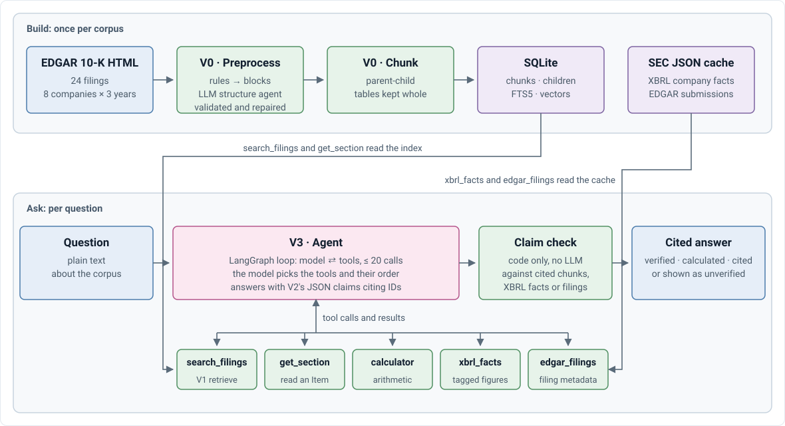
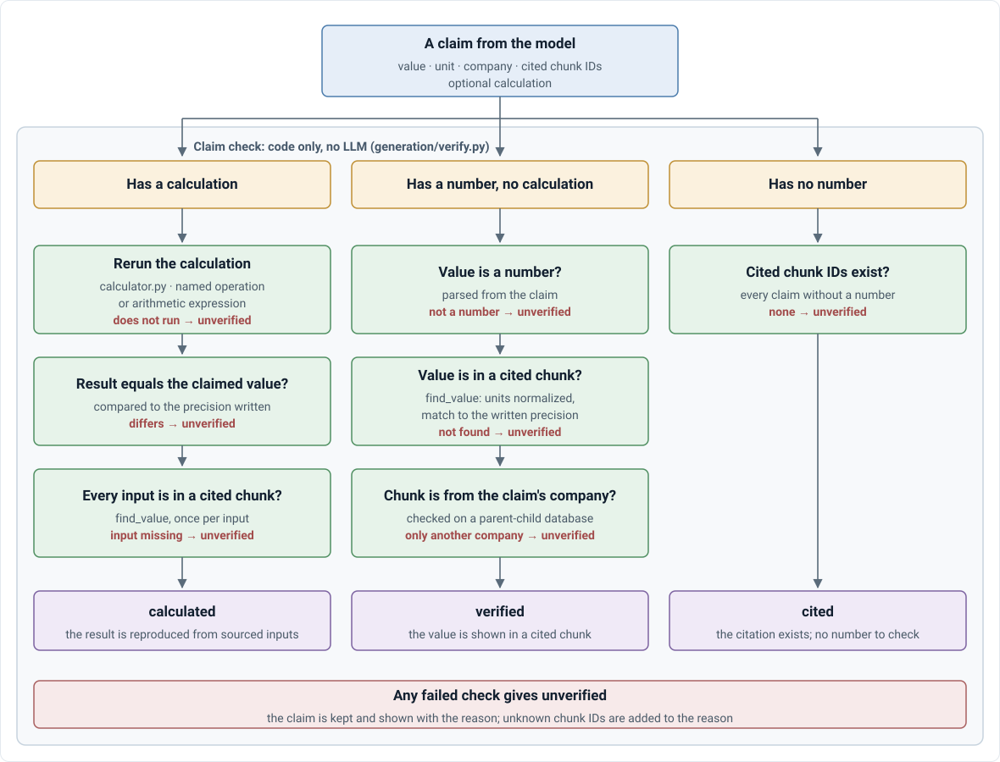

# V3 architecture: cited answers about 10-Ks

What V3 does, what it guarantees, and how it is put together. V3 is the regression corpus (`companies-v3.yaml`); V4 is described in the [V4 design doc](../V4_TECHNICAL_DESIGN_DOC.md). Repository overview: [ARCHITECTURE.md](../ARCHITECTURE.md). To run it: [GETTING_STARTED.md](../GETTING_STARTED.md).

## Scope and guarantees

**V3.** Questions about the annual reports (10-Ks) of a fixed corpus, answered from the filings alone. V4's guarantees differ: see the [V4 design doc](../V4_TECHNICAL_DESIGN_DOC.md#25-cross-cutting-rules).

| Guarantee | How it is kept |
|---|---|
| Every number comes from a cited passage, never from the model's memory | The prompt requires it; each claim is then checked against the chunks (or the XBRL facts) it cites ([generation spec](V2_GENERATION.md#how-it-works), [D-036](../DECISIONS.md#d-036)) |
| Fiscal years come from filing metadata, never from text | `filings.fiscal_year` from the XBRL cover page ([D-004](../DECISIONS.md#d-004)) |
| Unverifiable claims are shown as unverified, not hidden | Claim status `unverified`, with the reason |
| Questions outside the corpus are declined | `abstained: true` and a scope notice |
| No stock prices, forecasts or investment advice (V3) | Declined by the prompt ([D-001](../DECISIONS.md#d-001)); V4 allows them as labeled drafts ([D-038](../DECISIONS.md#d-038)) |

**V3 corpus** (`companies-v3.yaml`, kept as a regression check). Apple, Microsoft, Amazon, Alphabet, Meta, NVIDIA, Tesla, Netflix × fiscal years 2023–2025 (24 10-Ks), chosen because their fiscal years end in different months: "NVIDIA's revenue in 2024" is mostly its fiscal 2025 ([D-001](../DECISIONS.md#d-001)). Built and tested so far: the FY2025 filings of AAPL, AMZN, MSFT and NVDA.

**Out of scope (V3).** Prices, forecasts, advice ([D-001](../DECISIONS.md#d-001)); a public deployment ([D-023](../DECISIONS.md#d-023)); verification-by-tools, model comparison and fine-tuning.

## Pipeline

  

The system was built in stages (the V0–V3 experiments), each tested on its own before the next was built. The specs and experiment reports keep those names.

| Component | Does | Spec | Experiment and results |
|---|---|---|---|
| **Parsing and chunking** | 10-K HTML → blocks (rules) → labels (LLM structure agent, validated and repaired) → one structured document → chunks, three ways | [spec](V0_PARSING_CHUNKING.md) | [V0](../../experiments/V0_PARSING_CHUNKING.md): rule-based and parent-child level (~93% exact heading paths, every risk factor on its own) |
| **Retrieval (`search_filings`)** | Sub-questions per company and filing → keyword + dense → RRF → rerank → round-robin. No LLM | [spec](V1_RETRIEVAL.md) | [V1](../../experiments/V1_RETRIEVAL.md): parent-child best, Recall@5 87.3%, MRR 0.758 |
| **Generation and claim check** | JSON answer with claims citing chunk IDs → each claim checked | [spec](V2_GENERATION.md) | [V2](../../experiments/V2_GENERATION.md): 21 / 30 number questions right, 8 / 8 declines, every numeric claim grounded (one call over the top 8 chunks, no tools) |
| **Agent** | The model drives: search, calculate, XBRL facts and EDGAR metadata (LangGraph) → JSON answer and claim check | [spec](V3_AGENT.md) | [V3](../../experiments/V3_AGENT.md): 88.5% (10-K tools) and 87.2% (+ SEC data) of 78 questions right vs V2's 66.7% |

Each stage spec covers: data, knobs, outputs, how it works, gotchas.

### Zoom in: the search_filings tool

The [pipeline](#pipeline)'s **Preprocess**, **Chunk** and **SQLite** blocks and its **search_filings** tool, opened up (dashed frames carry the pipeline's block names). The build runs once; the tool runs on every call the agent makes and returns chunks the agent can cite. The tool is the V1 retrieval, with one addition: companies and fiscal years the agent passes replace those found in the query, and a search that names no company returns an error asking for one instead of searching the whole corpus.

  

### Zoom in: claim check

The pipeline's **Claim check** block, opened up. Each claim the model returns is checked on its own, with code only (`generation/verify.py`, run inside `generate()`):

  

Evaluation does not run this check; it reads the statuses (below). An unknown chunk ID is added to the reason whatever the status. Unverified claims are shown to the user with the reason, not hidden.

## Models

Answers, the agent and the judge go through `Model.complete(messages)` (`src/tenk_agent/models.py`); providers (vLLM or any OpenAI-compatible server, the Anthropic SDK) translate one neutral message format ([D-013](../DECISIONS.md#d-013)). The V0 structure agent and agentic chunker call vLLM's OpenAI API directly, for schema-constrained decoding. V4 uses the same layer. Serving and choosing a model: [SERVING.md](../SERVING.md).

## Evaluation

Evaluation never runs the pipeline, including the claim check. It takes the pipeline's output, the generated answer with its claim statuses and the chunks the model was shown, and grades it against the gold set. The only LLM in it is the judge, and only for text answers.

  

| Step | Code | LLM? |
|---|---|---|
| Gold chunks | `gold.resolve_evidence`, `retrieval_metrics.gold_chunks` | No |
| Number questions, declines | `scoring.grade`, `answer_metrics` | No |
| Text questions | `judge.py`, then `scoring.correct` again (`experiments/v2/judge.py`) | **Yes** |
| Aggregate and report | `scoring.summarize`, `report.build_report` | No |

`correct` does not depend on the claim statuses. A number that is in the answer text counts even if its claim is `unverified`; the claim statuses are reported as the grounded count.
