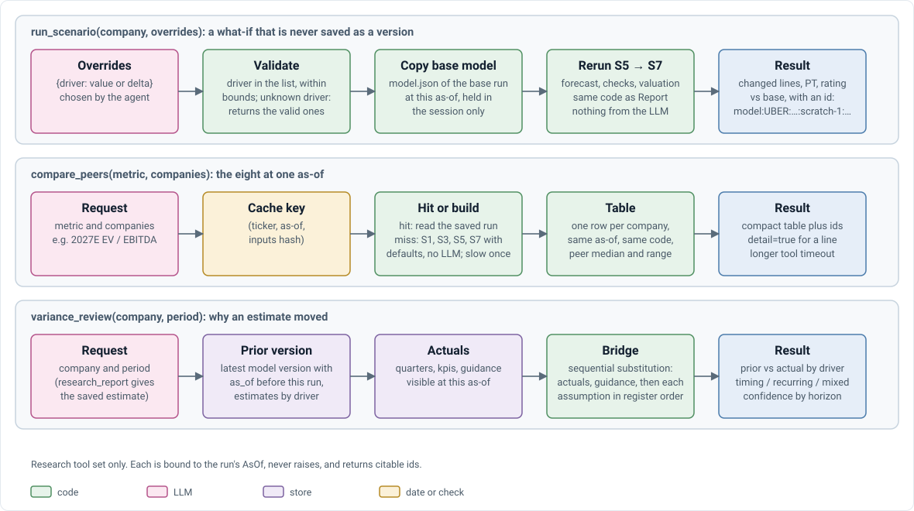

# V4 · Agent and tools

How the agent loop, its tools and its sub-agents work. Rules live in the [design doc §3](../V4_TECHNICAL_DESIGN_DOC.md#3-tools) and [§6](../V4_TECHNICAL_DESIGN_DOC.md#6-agent-runtime); if this doc disagrees, the design doc wins. V3's loop: [V3_AGENT.md](V3_AGENT.md).

## The loop

```text
question ─► model ──tool calls──► tools ─► model ─► … ─► JSON answer ─► claim check
```

`agent/loop.py` (LangGraph) runs it:

| Situation | What happens |
| --- | --- |
| First turn | Must call a tool |
| Same call repeated | Returns an error; still counts toward the budget |
| Over `max_calls` or `max_context` tokens | One last turn with tools off |
| Reply isn't valid JSON | One "only the JSON" retry |
| Answer returned | The claim check verifies each claim ([V4_VERIFICATION.md](V4_VERIFICATION.md)) |

**Context stays small.** State lives in files, not chat. Each call sees only what it needs (a debate sees one driver; a section writer sees only its facts) and fetches detail by id.

## Tools

`agent/tools.py` holds the schemas the model sees and one handler per tool. A run only gets the tool groups of its set. A failing handler returns `{"error": …}` listing the valid choices, rather than crashing.

<p align="center">
  
</p>

| Tool | What it does |
| --- | --- |
| `financials` | Quarterly and annual figures, cited as `q:` / `xbrl:` ids |
| `research_report` | The latest saved report visible at the as-of |
| `model_view` | The base model at the session's as-of |
| `run_scenario` | Reruns forecast and valuation with changed assumptions (clipped to bounds); saved as `scratch-n` |
| `compare_peers` | Builds each peer's model on first use, then reuses it |
| `variance_review` | The last forecast before a release vs the reported actual, with a revenue bridge |

## Sub-agents

Three Report steps hand a task to a small, budgeted agent with the `ask` tools:

| Sub-agent | Task | Code |
| --- | --- | --- |
| Events (S2) | What happened this quarter | `research/subagents.py` |
| Proposer (S4) | Suggest assumption changes (off by default) | `research/propose.py` |
| Debates (S9) | Bull and bear case per scenario driver | `research/subagents.py` |

Each returns JSON. **An item is kept only if one of its evidence ids resolves.** A debate's evidence values become facts the note can cite.

## Filing text: what reaches the note

No prompt names a filing section such as Item 1A. Prompts give a *topic*; the LLM writes its own `search_filings` queries.

| Step | Reads | Looks for | Ends up in |
| --- | --- | --- | --- |
| KPI extraction | Earnings release | Labels in `facts/kpis.yaml` (code picks passages) | Numbers only |
| Events | 10-K, 10-Q, release | Event types in `events.md` | Note section 8 |
| Debates | 10-K, 10-Q, release | Management's explanations, risk factors | Note section 3 |
| Proposer | 10-K, 10-Q, release | Reasons listed in `propose.md` | Assumptions |
| Note prose | Nothing | Only its own facts | All prose |

- **Events:** up to 8 per run. Section 8 prints only `catalyst`, `regulation` and `m&a`; other types stay in `events.json`.
- **Risk factors** reach the note only via debate bull and bear lines. Section 7 is code-computed sensitivities. Recall is not measured.

**Open questions**

| Question | Current view |
| --- | --- |
| Print other event types? | Open. `definition_change` and `business_model` look most useful, since they affect model inputs |
| Query Item 1A and MD&A directly? | Wait until a miss rate is measured |

## Tests

| File | Checks |
| --- | --- |
| `test_agent_loop.py` | Tool results feed the next turn; budget, retry, repeat and long-context rules |
| `test_agent_tools.py` | Calculator; offline data never fetches; cited values verify, other companies' don't |
| `test_ask.py` | Guidance periods; ids resolve at the as-of; prompt names the as-of and coverage |
| `test_forecast.py` | Proposals are bounded and need evidence |

Gold sets: Ask (79) and Research (72), see [V4_EVALUATION.md](V4_EVALUATION.md).
