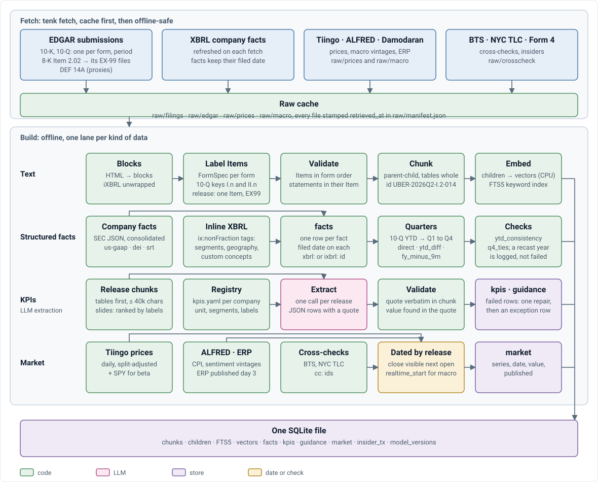
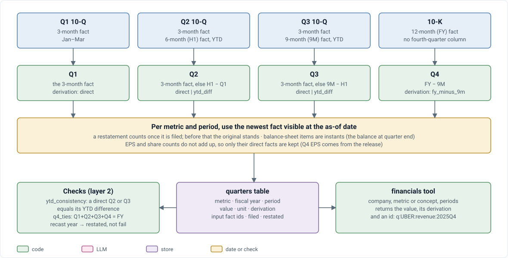

# V4 · Data layer: how it works

Companion to [design doc §4](../V4_TECHNICAL_DESIGN_DOC.md#4-data-layer), which holds the contract (components, interfaces, rules, failure handling, constraints). This doc explains how the block meets it: the build, the algorithms, implementation notes and tests. It does not restate the rules; where the two disagree, the design doc wins.

## The build

<p align="center">
  
</p>

`tenk fetch` writes the raw cache; `tenk build` runs four lanes into one SQLite file: text (chunk, load, embed), facts (company facts, inline XBRL), KPIs (LLM extraction, [V4_EXTRACTION.md](V4_EXTRACTION.md)), market (prices, macro, ERP, cross-checks). `--stage append` loads new filings into an existing database.

## Quarter derivation

<p align="center">
  
</p>

`facts/quarters.py`, on every read:

```text
Q1        the ~90-day fact
Q2, Q3    the ~90-day fact; else H1 − Q1, 9M − H1 (year-to-date difference)
Q4        FY − 9M
instants  as reported, no derivation
each      the newest fact visible at D (.latest()), one concept per fiscal year
```

Each quarter records its derivation (`direct`, `ytd_diff`, `fy_minus_9m`), its input fact ids and `filed` (the latest input). Duration ids carry the start date because three-month and year-to-date facts share an end date (build log §3.3).

## Text processing

Rules (`FormSpec` per form, `preprocess/forms.py`) split each filing into Items (D-039). Chunks are parent-child (V0); tables stay whole chunks (D-003). Chunk headers name the form and period ("Uber Q2 2026 10-Q, Part I Item 2 MD&A") so a chunk read alone says where it is from.

## Implementation notes

| Note | Why |
|---|---|
| NYC TLC aggregated to trips per month per license at fetch | Each month's Parquet is ~540 MB (build log §3.5) |
| Company facts and inline XBRL both load into `facts`, `source` tells them apart | Company facts lacks dimensions and company concepts (build log §3.3) |
| `metrics.yaml` lists concepts per metric in priority order; the first present in a fiscal year is used for the whole year | One concept per year (design §4.3) |
| A failed company's fetch is logged and skipped (`fetch_records_filings_and_skips_failed_companies`) | Design §4.4 |

## Tests

| File | Asserts |
|---|---|
| `test_asof.py` | strictly-before; `.latest()` takes the newest visible restatement; a store sees nothing from a filing until the day after; V4 modules always pass an `AsOf`; V3 databases migrate and backfill dates |
| `test_facts.py` | quarters from year-to-date facts; no Q4 before the 10-K; a restatement replaces the original once filed; one concept per year; inline facts keep dimensions and company concepts; a recast year reads `restated` |
| `test_filings_v4.py` | strict quarter-before; period keys; releases checked against reports; two filings for one period flagged; EX-99 rows from the index; proxies keyed to the prior year |
| `test_market.py` | an as-of sees the previous close; revised series use the vintage known then; daily series are published the next day; ERP fetch records its retrieval |
| `test_acquisition.py` | User-Agent required; window and dedupe; Item 2.02 8-Ks only; `verify` flags FYE, CIK and missing forms |
| `test_store.py`, `test_rules.py` | chunk loading and filters by period and form; KPIs and guidance dated by their release; 10-Q Items carry their Part; release exhibits become pseudo-Items |

V3 regression: `experiments/v4/v3_regress.py` checks byte identity of the shared pipeline on the V3 corpus.
