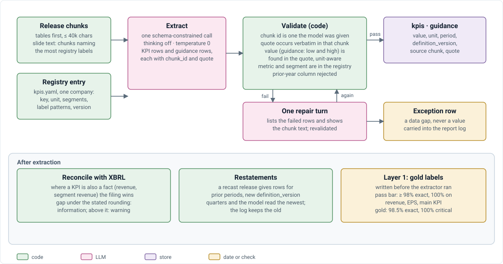

# V4 · KPI extraction

How KPIs and guidance are pulled from earnings releases. Rules live in the [design doc §7](../V4_TECHNICAL_DESIGN_DOC.md#7-extraction-layer-1); if this doc disagrees, the design doc wins.

  

## Per release

1. **Pick text.** The release's chunks, tables first, up to 40k characters. (Slide-image releases: the chunks naming the most KPI labels.)
2. **One LLM call** with the KPI list for that company in the prompt (`extract.md`).
3. **Code checks each row:**
   - Chunk id given?
   - Quote appears verbatim in the chunk?
   - Value appears in the quote (unit-aware)?
   - Metric and segment are on the list?
4. **One repair turn** for failing rows, showing the chunk text. Still failing → an exception row.
5. **Store** valid rows with their filing date and definition version.

## Lessons learned

| Rule | Why |
| --- | --- |
| Thinking off, temperature 0 | With thinking on, calls used all their tokens reasoning and returned no JSON |
| No "…" in quotes; quote from label to number | Shortened quotes failed the verbatim check |
| Reject a prior-year column | Two-column tables tempt the model to take last year's value |
| Tables first, then KPI-matched chunks | Fits the token budget; slide releases have no tables |
| Growth or margin guidance converted to a level via last year's actual | The forecast needs a level |

## Tests and results

`test_extract.py`: valid rows kept, bad ones repaired once; unknown metrics and values not in the quote rejected; only that release's chunks sent; the KPI list covers all eight companies.

Gold: 337 labels (`evaluation/gold/extraction-gold.jsonl`). **98.5% exact, 100% on critical KPIs** ([V4_RESULTS.md](../V4_RESULTS.md)).
