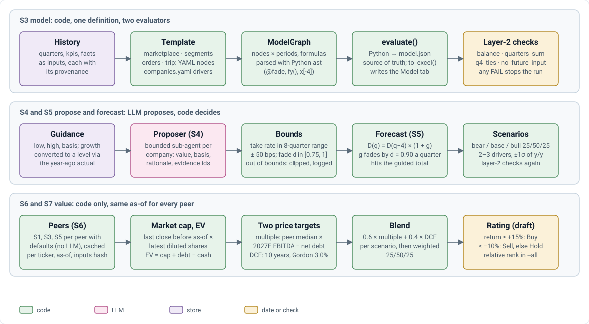

# V4 · Model engine and valuation: how it works

Companion to [design doc §8](../V4_TECHNICAL_DESIGN_DOC.md#8-model-engine-and-valuation), which holds the contract (templates, schemas, forecast rules, valuation, layer-2 checks). Equations and parameters: [V4_FINANCIAL_MODELING.md](V4_FINANCIAL_MODELING.md). This doc does not restate the rules; where the two disagree, the design doc wins.

## Steps S3 to S7

<p align="center">
  
</p>

```text
S1 data pack   every input with id and filed; shares and per-share points on the latest split basis
S3 history     template + statements.yaml → graph; inputs filled from the data pack; layer-2 checks
S4 proposer    (off by default) bounded overrides of .g0, .shift0, fade
S5 forecast    defaults → outside inputs → proposer → anchors (bracketing search) → scenarios; layer-2 again
S6 peers       same-sector models with defaults, cached in the model book
S7 value       market cap, EV, peer multiples, DCF, PT per scenario, weighted PT, rating; valuation checks
```

**One definition, two evaluators.** `dsl.py` parses each expression once; `graph.py` evaluates it in Python (writing `model.json`) and renders the same node as an Excel formula for the workbook (D-041).

**Anchors.** For each guide in order (bookings → revenue → EBITDA), a bracketing search finds the value of its one assumption that makes the guided line hit the midpoint, within the assumption's bounds; if the bounds stop it, the closest value is kept and the miss is logged.

**Outside inputs** (`research/outside.py`, D-045). x = the series' mean y/y over the 3 latest months visible at D. The fit regresses the driver's history y/y on x taken at the same lag before each quarter (≥ 6 quarters). g0 = (1 − w) × default + w × (a + b·x), with w = 0.5 × R²; a slope ≤ 0 is not used. Mappings: BKNG, EXPE, ABNB volume and TRIP revenue ← BTS airline passengers; UBER Mobility bookings ← TLC HV0003; LYFT rides ← TLC HV0005; DASH orders ← FRED RSFSDP and order value ← CPI; CART order value ← CPI.

## Implementation notes

| Note | Why |
|---|---|
| Balance includes redeemable NCI and temporary equity; EXPE's liabilities derived from the reported total | UBER, DASH and CART tie only that way (build log §3.12) |
| Shares and per-share points on the latest filing's split basis | BKNG's 25-for-1 split mixed bases (build log §3.12) |
| Adj. EBITDA = revenue − costs as a share of GB (all GB-based templates) | A margin on GB left a take-rate cut without effect on EBITDA (build log §3.13) |
| A quarter missing last year steps from two years back (`first()`); an incomplete last year falls back to the q-4 rule | ABNB's unextracted 2025 GBV (build log §3.13) |
| A full-year-only guide anchors the FY column | ABNB guides only a full-year margin (build log §3.13); a gap against the spec (design §13.1) |
| The proposer skips anchored assumptions (`propose.py`) | The anchor runs after and would undo it |

## Tests

| File | Asserts |
|---|---|
| `test_model_dsl.py` | one expression, two evaluators; `fy`, `fyp`, `first`; missing inputs give None, not 0; anything else rejected (`rejects_anything_else`) |
| `test_model_graph.py` | checks pass on a consistent model and fail on a broken one (each check); `no_future_input` fails on a late filing; split basis; alternative part lists; temporary equity summed |
| `test_model_workbook.py` | inputs blue, formulas black; parity with LibreOffice |
| `test_forecast.py` | growth starts at last y/y and fades; ratios within bounds; shifts hold until lapped; seasonal shares from the latest three complete years; forecast cells are formulas; anchors hit the midpoint and log when out of bounds; proposals bounded with evidence; forecast parity |
| `test_credentials_outside.py` | the outside-input fit and lag window; a missing, blank or placeholder credential raises an error naming it; `tenk fetch` without credentials exits 2; the example file holds only placeholders |
| `test_valuation.py` | DCF falls as WACC rises; negative flows give a negative DCF; terminal share grows with g; relative ratings by thirds; deterministic rounding; market value |
