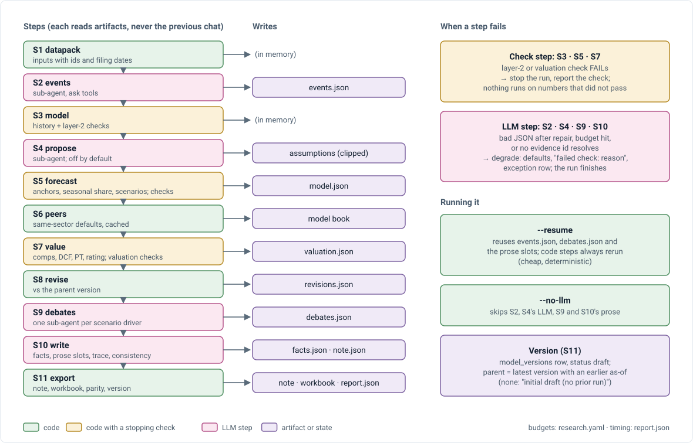

# V4 · Report pipeline: how it works

Companion to [design doc §9](../V4_TECHNICAL_DESIGN_DOC.md#9-report-pipeline), which holds the contract (steps, artifacts, rules, note sections, consistency check). This doc does not restate the rules; where the two disagree, the design doc wins.

## The runner

  

`research/pipeline.py` `run()` looks up the parent version, then runs S1–S11 in order, timing each step (seconds, LLM calls, tokens) into `report.json`. Code steps always rerun; with `--resume` the LLM outputs already in the folder (`events.json`, `debates.json`, prose slots) are reused. S11 writes the files and the `model_versions` row last, so a failed export saves no version.

## The note

`research/note/sections.py` builds the ten sections from the artifacts: code writes every table and fixed block; each prose slot (`takeaways`, `quality`, `valuation`) gets only its own facts. `write.py` makes one LLM call per slot, traces it ([V4_VERIFICATION.md](V4_VERIFICATION.md)), repairs once, and drops what stays untraced. Sections 1 and 10 are built last, after the consistency check numbers the exceptions.

## Tests

`test_note.py` (13): number figures skip dates, periods and ids; true figures trace; seeded errors are caught; a table cell changed to another fact's value is caught; prose traces to its own slot only; the writer drops sentences still untraced after repair; consistency passes a consistent note and catches each inconsistency. Pipeline runs with `--no-llm` on all eight (build log §3.15). Layer 5: [V4_EVALUATION.md](V4_EVALUATION.md).
