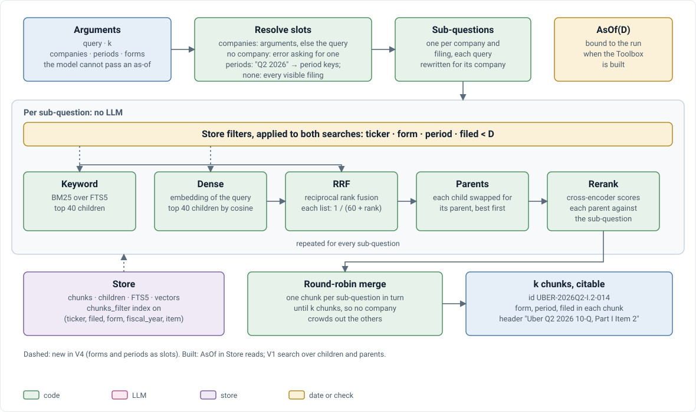

# V4 · Retrieval: how it works

Companion to [design doc §5](../V4_TECHNICAL_DESIGN_DOC.md#5-retrieval), which holds the contract. The stage itself is V1's ([V1_RETRIEVAL.md](V1_RETRIEVAL.md)); this doc covers what V4 changed: slots by period and form, and the as-of filter. It does not restate the rules; where the two disagree, the design doc wins.

## The search

  

| Step | What it does | Why |
|---|---|---|
| Slots | Companies from the arguments, else the query; periods to keys; none = latest filing of each form at D | D-010 |
| Sub-questions | One per (company, filing), rewritten to name only that company | D-010, V1 |
| Search | BM25 over FTS5 and dense over children, top 40 each, under the store filter | Keywords catch figures and names, vectors catch paraphrase (V1) |
| Fusion | Reciprocal rank fusion, k = 60 | Rewards agreement between the two lists without tuning scores (V1) |
| Parents | Each child swapped for its parent | Children match precisely; parents give the whole subsection or table (V0, D-037) |
| Rerank | Cross-encoder per parent and sub-question | Best precision at the top (V1) |
| Merge | Round-robin across sub-questions until k | No company crowds out the others (V1) |

## Tests

`test_retrieval.py`: company aliases resolve; sub-questions name only their company and fan out; every filing named returns evidence; vector search orders by cosine; RRF rewards agreement; given companies and years replace those in the question. `test_asof.py` covers the filter. The V1 retrieval gold (V3 corpus) runs through the regression check.
