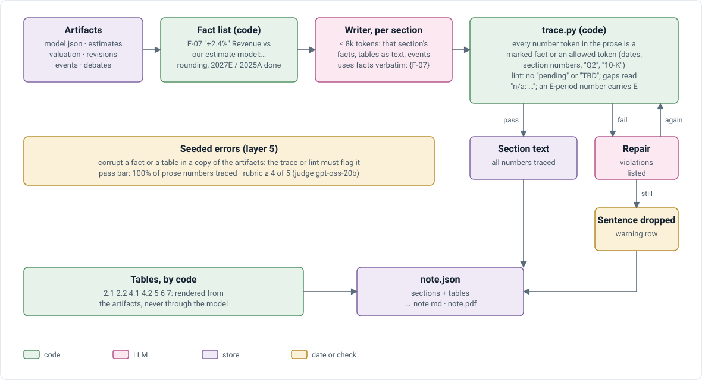

# V4 · Verification and number trace: how it works

Companion to [design doc §10](../V4_TECHNICAL_DESIGN_DOC.md#10-verification-and-number-trace), which holds the contract (reference grammar, fact list, log, trace rules). This doc does not restate the rules; where the two disagree, the design doc wins.

## Claim check

`generation/verify.py` takes each answer claim, resolves its cited ids with `research/refs.py` `Resolver` (bound to the run's `AsOf`; `model:` ids through the model book), and compares values with `find_value`, which normalizes units and respects the rounding the claim was written with. A claim with a `calculation` is rerun from resolved inputs.

## Number trace

<p align="center">
  
</p>

```text
facts.json  ← code builds every printable figure, pre-formatted, with its source id
writer      → prose with {F-n} marks, one slot at a time
trace.py    numbers_in(text) finds every figure (signs, scales, percentages);
            each must be a marked fact of this slot or an allowed token;
            each code block must appear verbatim
            violations → one repair turn → still failing → sentence dropped, X-n error
```

## Tests

`test_refs.py`: every kind parses; XBRL ids name a duration's start; the resolver reads V3 and V4 XBRL ids. `test_generation.py`: `numbers_in` reads signs, scales and percentages; `find_value` normalizes units and respects the rounding of prose figures. `test_agent_tools.py` and `test_ask.py`: claims verify against facts and data rows; another company's fact doesn't. `test_note.py`: trace, lint and seeded errors ([V4_REPORT.md](V4_REPORT.md)).
